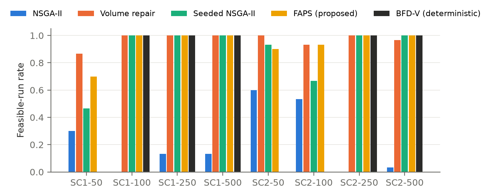
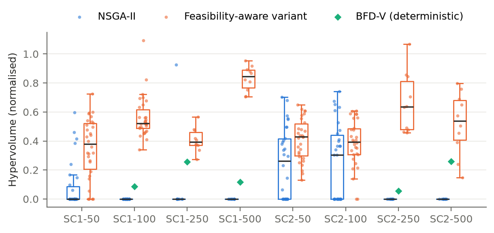
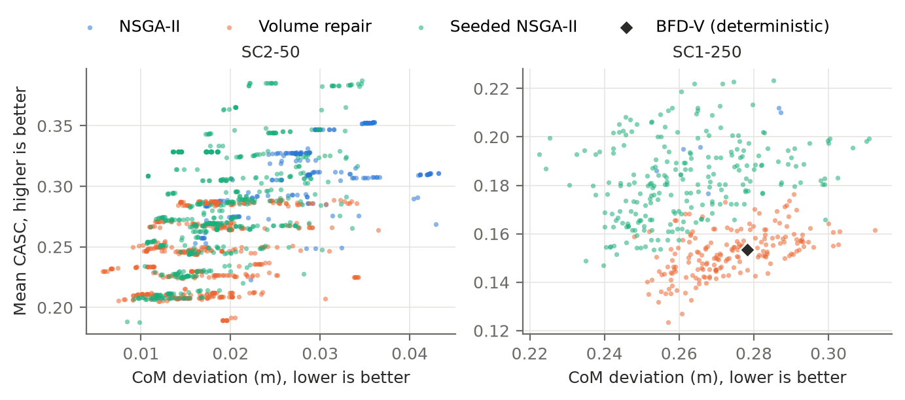

# Feasibility Decides the Trade-off: Volume-Ordered Repair in Multi-Objective Spacecraft Payload Packing

**Authors:** [Author names, affiliations and contact details to be supplied by the authors]

## Abstract

Stowing cargo in a spacecraft logistics module couples a packing problem with two conflicting goals: keeping the centre of mass (CoM) near its target and keeping items accessible. We study this problem as bi-objective search with NSGA-II over packing sequences and orientations, decoded by an Extreme Point (EP) heuristic, on twelve synthetic instances with 50 to 500 items. We use a matched-budget protocol (720 runs; 30 seeds for N ≤ 100, 10 for N ≥ 250) with paired tests and Holm correction.

Plain NSGA-II rarely returns a valid packing: it finds one in at most 18 of 30 seeds on any instance and in none on four of eight solvable instances. A Baldwinian repair, which re-decodes failed chromosomes in decreasing-volume order, finds valid packings in 26 to 30 of 30 seeds. Its hypervolume is significantly higher on seven of eight instances (Holm-adjusted p ≤ 0.05), robust to halving or doubling every accessibility constant. It also exceeds a deterministic best-fit-decreasing construction on all five instances where that construction is feasible. Three further findings qualify this result:

- On seeds where both methods are feasible, hypervolume does not differ.
- The repair shifts solutions toward low CoM deviation at the cost of accessibility.
- Ablation shows the gain comes entirely from the volume order: a random-order repair is no better than no repair. Orientation search is also essential.

The dense scenario (96% volume utilisation) produced no valid packing for any method. Evaluations of packing optimisers should therefore report feasibility separately from front quality. A batched GPU scorer, corrected for a padding defect, speeds up scoring 4–6× on a laptop GPU.

**Keywords:** spacecraft logistics; three-dimensional packing; multi-objective evolutionary algorithms; constraint handling; repair; NSGA-II; hypervolume; reproducibility

## 1. Introduction

Cargo for a crewed spacecraft must be packed so that the vehicle's centre of mass stays within tolerance. It must also remain retrievable by the crew, who reach in through an access face and may have to remove items to reach the one they need. The two goals conflict. Dense packings that satisfy CoM constraints tend to bury items, and accessible packings tend to load mass unevenly. Multi-objective evolutionary algorithms (MOEAs) are a natural tool for exposing this trade-off, because they return a set of compromises rather than a single packing.

A decoder-based MOEA searches over packing sequences and orientations and converts each chromosome into a layout with a placement heuristic. This design, common in container loading (Gonçalves and Resende, 2013), has a weakness that is easy to overlook. The decoder may fail to place every item, so a chromosome can describe an invalid packing. Constrained-domination selection (Deb, 2000; Deb et al., 2002) steers the search toward feasibility but does not guarantee it. If the evaluation then compares fronts without accounting for feasibility, it compares invalid layouts, or it silently rewards whichever method happens to find any valid one.

This paper studies that issue in a bi-objective CoM–accessibility packing model. We make four contributions:

1. **A matched-budget evaluation protocol** that separates feasibility from front quality. It reports feasible-run rates, uses hypervolume against pooled feasible reference fronts, and applies paired, family-wise-corrected tests over seeds. The study covers twelve instances, 720 runs, three single-construction heuristics and random search (Sections 4–5).
2. **A Baldwinian, volume-ordered repair for NSGA-II** that makes the search return valid packings in nearly every run, where plain NSGA-II rarely does (Section 3.5, Section 6.1).
3. **An analysis of where the improvement comes from.** It holds against a deterministic constructive baseline and under perturbed objective constants (Sections 6.2–6.3). It disappears when both methods are feasible (Section 6.4), it biases the trade-off toward CoM at the expense of accessibility (Section 6.4), and it is caused by the volume order rather than by a second decoding attempt (Section 6.5).
4. **A corrected and tested batched GPU scorer.** The original scorer treated padding rows as items, which biased the accessibility objective of every infeasible layout. We give the scoring-stage speed of the corrected scorer (Section 6.6).

The study does not validate the accessibility surrogate against crew data, model launch-load restraint, or claim a whole-run GPU speedup. Section 8 states these limits.

## 2. Related Work

**Three-dimensional packing.** Martello, Pisinger and Vigo (2000) established exact and heuristic methods for three-dimensional bin packing. Crainic, Perboli and Tadei (2008) introduced Extreme Points (EP) as placement candidates, which our decoder uses. Gonçalves and Resende (2013) encode a packing as a sequence and orientation genotype decoded by a placement heuristic, searched with a biased random-key genetic algorithm. Our chromosome follows the same decoder-based design, with permutation operators and two objectives. Bortfeldt and Wäscher (2013) review the practical constraints of container loading. In their terms, our CoM objective is a weight-distribution criterion and our accessibility objective is a positioning criterion. Load stability, also in their taxonomy, is not modelled here and is tested only through an ablation (Section 6.5).

**Spacecraft cargo stowage.** Cargo accommodation for the International Space Station has been supported by an operational optimisation tool, CAST, which combines global optimisation and heuristics with balancing and positioning rules (Fasano, Lavopa, Negri and Vola, 2015). Ho (2023) reviews space logistics modelling and optimisation at the campaign and network level rather than the stowage level. We found no study that pairs a CoM objective with an accessibility objective under an EP decoder and evaluates methods under a matched budget. This reflects our search, not a guarantee that none exists.

**Constraint handling in MOEAs.** NSGA-II (Deb, Pratap, Agarwal and Meyarivan, 2002) handles constraints by constrained domination, following Deb's (2000) feasibility rules: feasible solutions dominate infeasible ones, and infeasible solutions are ranked by total violation. We use the pymoo implementation (Blank and Deb, 2020). Our repair acts at a different point. It changes the decoder's output for a chromosome, not the selection rule, and leaves the genotype unchanged. This is a Baldwinian repair: the repaired phenotype determines fitness, but the repaired sequence is not written back.

**Evaluation methodology.** Hypervolume as a quality indicator for front approximations goes back to Zitzler and Thiele (1999). For comparing stochastic algorithms over several problems we follow Derrac, García, Molina and Herrera (2011): nonparametric tests paired per problem and a family-wise correction across problems.

**GPU evaluation.** Özcan, Dokeroğlu, Coşar and Yazıcı (2016) run a grouping genetic algorithm for one-dimensional bin packing on a GPU. Our batched scorer addresses three-dimensional objectives and is reported only as a scoring-stage measurement.

## 3. Problem and Method

### 3.1 Solution representation

A solution is a permutation σ of the N items together with an orientation vector o ∈ {1,…,6}ᴺ. Each orientation selects one of the six axis permutations of an item's width, depth and height.

### 3.2 Decoder

The EP decoder places items in the order σ. Each item is tried, in its chosen orientation, at the current extreme points sorted by z, then y, then x. It is placed at the first point where it lies inside the container and overlaps no placed item, and the extreme points are then updated. An item with no valid point is left unplaced.

The access face is the plane z = 0, and z is depth from that face. Because extreme points are sorted by z first, the decoder fills the container from the access face inward. The decoder does not require an item to touch the items nearer the access face. Section 6.5 tests a contact constraint as an ablation.

### 3.3 Constraints and objectives

A layout is feasible if every item is placed. The constraints are g₁ = total unplaced volume ≤ 0 and g₂ = number of unplaced items ≤ 0.

- **f₁, CoM deviation (minimise).** The Euclidean distance between the system centre of mass and a target point t = (0.5, 0.5, 1.0) m. The system includes a dry mass of 5000 kg located at t. Because t is absolute while container sides range from 1.37 to 3.17 m, Section 6.3 also tests a target at the container centre.
- **f₂, accessibility (maximise; implemented as minimising −CASC).** For each packed item i, CASC_i = exp(−c_i), with c_i = c_reach + c_occ + c_ext.
  - c_reach = (z_i / L_arm)² with L_arm = 0.75 m.
  - c_occ = λ (1 − v_i), with λ = 1, where v_i is the visible fraction of item i's footprint, measured on a 10 × 10 grid and counting only items nearer the access face.
  - c_ext = Σ_j ρ_j (C_grasp + κ m_j), summed over the transitive blockers j of item i, with C_grasp = 2, κ = 0.05 kg⁻¹, and ρ_j = 0.4 for consumable or waste items and 1 otherwise.

  The objective is the mean of CASC_i over packed items.

A layout with no packed item receives f₁ = 9999 and f₂ = 0.

### 3.4 Optimiser

We use NSGA-II as implemented in pymoo, with constrained domination on (g₁, g₂). Population and generations are 100 and 100 for N ≤ 100, and 50 and 50 for N ≥ 250. The operators are:

- **Crossover:** OX1 order crossover on the sequence and uniform crossover on the orientations (mask 0.5), applied with probability 0.9.
- **Mutation:** swap or inversion on the sequence, and reset on each orientation gene, each with probability 1/N.
- **Duplicates:** eliminated.

### 3.5 Volume-ordered Baldwinian repair

The repaired variant changes only the evaluation function:

```
evaluate(σ, o):
    layout ← EP-decode(σ, o)
    if layout leaves an item unplaced:
        σ' ← σ stably re-sorted by decreasing item volume
        layout' ← EP-decode(σ', o)
        if unplaced-volume(layout') < unplaced-volume(layout):
            layout ← layout'
    return f₁(layout), f₂(layout), g₁(layout), g₂(layout)     # σ and o unchanged
```

Each evaluation costs one or two decoder calls. In the full run, the first decode failed in almost every evaluation: the repaired variant used 19,896 to 20,000 decoder calls per 10,000 evaluations. Section 6.6 reports the effect on runtime.

### 3.6 Baselines

- **Plain NSGA-II.** The same settings, without the repair.
- **Random search.** Uniform random chromosomes, with the same number of evaluations as NSGA-II on the same dataset and seed.
- **Single-construction heuristics.** These use the same EP decoder but try all six rotations at each extreme point and keep the first that fits. *First-Fit* (FF) takes items in dataset order, *Best-Fit-Decreasing by volume* (BFD-V) sorts by decreasing volume, and *BFD by priority* (BFD-P) sorts by a priority field. Each is deterministic and run once.

## 4. Experimental Design

### 4.1 Instances

There are twelve synthetic instances, HyperDock-Bench V1, with N ∈ {50, 100, 250, 500} and three scenarios. SC1 is consumable-heavy and SC2 is safety-item-heavy, both at 80% volume utilisation. SC3 has the SC1 item mix at 96% utilisation. Item sizes follow cargo-transfer-bag classes plus an irregular class, masses are lognormal by category, and each container is a cube sized to the target utilisation. Each instance is seeded deterministically from its identifier, and the committed generator reproduces all twelve files exactly. `docs/DATASETS.md` gives the distributions and per-instance statistics.

### 4.2 Protocol

Every dataset and seed is run with NSGA-II, the repaired variant and random search: seeds 1–30 for N ∈ {50, 100} and seeds 1–10 for N ∈ {250, 500}. That is 720 runs in total, plus 36 heuristic constructions. The protocol specified 30 seeds throughout. The reduction for the two largest sizes was a compute decision, because N = 500 runs take 11 to 20 minutes each. Every evaluated chromosome is archived, so the comparison uses all evaluations, not only the final population. The runs were executed on a laptop (28 logical CPU cores, NVIDIA RTX 4050 Laptop GPU, Python 3.12, pymoo 0.6.2, numpy 2.5.4, scipy 1.18.1, numba 0.68.1). All objective values come from the CPU reference scorer.

### 4.3 Metrics

- **Feasible-run rate:** the fraction of runs with at least one feasible evaluation.
- **Hypervolume (HV):** for each dataset, the feasible points of all methods and seeds are pooled, the objectives are min-max normalised on the pooled set, and HV is computed with reference point (1.1, 1.1). A run with no feasible point has HV 0.
- **IGD:** distance to the non-dominated pooled set, defined only for runs with a feasible point.

### 4.4 Statistics

Methods are compared per dataset with Wilcoxon signed-rank tests (two-sided) paired by seed. Effect size is Cliff's δ. Intervals for the mean HV are bootstrap 95% intervals (10,000 resamples, fixed RNG seed). Holm correction is applied across datasets within each comparison. A comparison where both methods have HV 0 in every run (all of SC3) is not a test, so it is excluded from the family. We also report the more conservative twelve-dataset family. The smallest attainable two-sided p-value is 2/2ⁿ: 0.002 for 10 seeds and 1.9 × 10⁻⁹ for 30.

## 5. Implementation Correctness

Two checks preceded the experiments, and both changed earlier conclusions.

**Batched scorer padding defect.** A batched PyTorch scorer packs a population on the CPU and evaluates the accessibility objective on the GPU. Unplaced items were passed as zero rows and scored as real items at the origin. This changed the blocking graph and the mean, with errors up to about 0.1 in mean CASC (for example, 0.489 against 0.445 for the same layout). The CoM objective was unaffected, because zero-mass rows contribute nothing. Fully packed layouts were scored correctly. An equivalence check that used only fully packed layouts therefore passed, although most layouts produced during search are partially packed. The corrected scorer masks padding rows. It matches the CPU reference to 7.9 × 10⁻⁸ (CASC) and 3.8 × 10⁻⁸ (CoM) on partially packed layouts, and regression tests cover that case. An earlier analysis of this system used the defective scorer and is superseded (Appendix A).

**Cross-environment reproducibility.** Every Pareto point from the laptop runs was re-decoded and re-scored in a separate Linux environment with different package versions. The objective values were identical, and the heuristic baselines produced identical layouts in both environments.

## 6. Results

### 6.1 Feasibility and hypervolume



**Table 1.** Full matched-budget run, repaired variant against plain NSGA-II. HV is the mean with its bootstrap 95% interval. Feasible runs count seeds with at least one valid packing. δ is Cliff's δ (variant against NSGA-II). Random search was infeasible in every run and is omitted. SC3 is omitted because no method found a valid packing there.

| Dataset | Seeds | NSGA-II HV | Variant HV | Feasible (NSGA-II / variant) | δ | p | p (Holm) |
|---|---|---|---|---|---|---|---|
| SC1-50 | 30 | 0.086 [0.032, 0.148] | 0.351 [0.277, 0.425] | 9 / 26 | 0.66 | 9.9 × 10⁻⁵ | 7.0 × 10⁻⁴ |
| SC2-50 | 30 | 0.246 [0.162, 0.331] | 0.411 [0.358, 0.461] | 18 / 30 | 0.41 | 0.0071 | 0.021 |
| SC1-100 | 30 | 0 | 0.563 [0.518, 0.618] | 0 / 30 | 1.00 | 1.9 × 10⁻⁹ | 1.5 × 10⁻⁸ |
| SC2-100 | 30 | 0.254 [0.162, 0.347] | 0.381 [0.321, 0.438] | 16 / 28 | 0.28 | 0.025 | 0.0496 |
| SC1-250 | 10 | 0.093 [0.000, 0.278] | 0.408 [0.361, 0.459] | 1 / 10 | 0.80 | 0.084 | 0.084 |
| SC2-250 | 10 | 0 | 0.664 [0.548, 0.794] | 0 / 10 | 1.00 | 0.0020 | 0.012 |
| SC1-500 | 10 | 0 | 0.831 [0.779, 0.881] | 0 / 10 | 1.00 | 0.0020 | 0.012 |
| SC2-500 | 10 | 0 | 0.520 [0.391, 0.643] | 0 / 10 | 1.00 | 0.0020 | 0.012 |

Plain NSGA-II returned a valid packing in at most 60% of seeds on any instance, and in no seed on four of the eight instances. The repaired variant did so in 87–100% of seeds. Its hypervolume is significantly higher on seven of eight instances after Holm correction, with SC2-100 marginal at 0.0496. SC1-250 is not significant: with ten seeds, NSGA-II's single feasible run there had a high hypervolume. In the conservative twelve-dataset family, six of eight remain significant (SC2-100 becomes 0.149 and SC1-250 0.420).



### 6.2 Comparison with single-construction heuristics

**Table 2.** Items packed by the deterministic heuristics (one run each). A dataset is feasible only if all N items are packed.

| Dataset | N | FF | BFD-V | BFD-P | BFD-V HV | Variant HV |
|---|---|---|---|---|---|---|
| SC1-50 | 50 | 49 | 47 | 49 | infeasible | 0.351 |
| SC1-100 | 100 | 97 | **100** | 97 | 0.087 | 0.563 |
| SC1-250 | 250 | 248 | **250** | 248 | 0.255 | 0.408 |
| SC1-500 | 500 | 499 | **500** | 494 | 0.116 | 0.831 |
| SC2-50 | 50 | 49 | 49 | 48 | infeasible | 0.411 |
| SC2-100 | 100 | 99 | 93 | 98 | infeasible | 0.381 |
| SC2-250 | 250 | 246 | **250** | 245 | 0.055 | 0.664 |
| SC2-500 | 500 | 498 | **500** | 497 | 0.259 | 0.520 |
| SC3-50 / 100 / 250 / 500 | — | 45 / 91 / 202 / 459 | 38 / 82 / 187 / 382 | 48 / 88 / 228 / 452 | infeasible | infeasible |

FF and BFD-P never pack every item. BFD-V, which uses the same decreasing-volume order as the repair, is feasible on five instances. On those five instances, where NSGA-II's feasible-run rate is between 0 and 0.1, the repaired variant's mean hypervolume exceeds BFD-V's single value. The search therefore adds front quality on top of the constructive order. Because BFD-V is deterministic, this comparison has no seed variance and is not tested. On SC1-50, SC2-50 and SC2-100, the variant finds valid packings that no heuristic finds.

### 6.3 Sensitivity to the objective definition

The CASC constants and the CoM target were chosen by hand. We re-decoded and re-scored every Pareto point from every NSGA-II and variant run under nine changed settings: each of L_arm, λ, C_grasp and κ halved and doubled, and the CoM target moved to the container centre. We re-ran BFD-V under each setting and recomputed the per-dataset statistics. With the original constants, this procedure reproduces Table 1 exactly.

**Table 3.** Robustness of the main comparison (eight SC1 and SC2 instances).

| Setting | Variant has higher mean HV | Holm-significant (α = 0.05) | Variant above BFD-V (of 5) |
|---|---|---|---|
| Original | 8 | 7 | 5 |
| L_arm × 0.5 / × 2 | 8 / 8 | 6 / 7 | 5 / 5 |
| λ × 0.5 / × 2 | 8 / 8 | 7 / 7 | 5 / 5 |
| C_grasp × 0.5 / × 2 | 8 / 8 | 6 / 7 | 5 / 5 |
| κ × 0.5 / × 2 | 8 / 8 | 7 / 7 | 5 / 5 |
| CoM target at container centre | 7 | 6 | 5 |

The direction of the result does not change under any change to the accessibility constants. Moving the CoM target reverses one instance, SC2-50 (0.337 against 0.352 for NSGA-II, p = 0.95). This analysis re-scores existing fronts rather than re-optimising, so it tests the robustness of the evaluation, not of the search.

### 6.4 When both methods are feasible

Table 1 compares runs that differ in feasibility. Table 4 restricts the comparison to seeds where both methods found a valid packing.

**Table 4.** Seeds on which both methods are feasible. The best values are the per-run minimum CoM deviation (m) and maximum mean CASC, averaged over these seeds. p is a paired Wilcoxon test. SC1-250 has a single such seed and is omitted.

| Dataset | Seeds | HV (NSGA-II / variant), p | IGD (NSGA-II / variant), p | Best CoM dev. (NSGA-II / variant) | Best CASC (NSGA-II / variant) |
|---|---|---|---|---|---|
| SC1-50 | 8 | 0.303 / 0.365, 0.55 | 0.480 / 0.448, 0.74 | 0.032 / 0.019 | 0.304 / 0.257 |
| SC2-50 | 18 | 0.410 / 0.384, 0.61 | 0.349 / 0.553, 4.2 × 10⁻⁴ | 0.027 / 0.014 | 0.286 / 0.230 |
| SC2-100 | 14 | 0.484 / 0.451, 0.58 | 0.254 / 0.304, 0.19 | 0.071 / 0.056 | 0.248 / 0.212 |

Conditional on feasibility, neither method has a significantly higher hypervolume. The fronts differ in position, though. On every instance, the repaired variant reaches lower CoM deviation and NSGA-II reaches higher accessibility. On SC2-50, NSGA-II's fronts are significantly closer to the pooled reference front (IGD). Figure 3 shows the same pattern.

There is a plausible mechanism. The repair decodes items from largest to smallest, so the largest items are placed first, at the access face. That keeps mass compact, which lowers CoM deviation, but buries smaller items behind large blockers, which lowers CASC. The repair therefore does more than restore feasibility. It also moves the search toward one part of the trade-off. Table 1's hypervolume gain comes from feasibility, not from better compromises among feasible layouts.



### 6.5 Ablation

Six one-component ablations of the repaired variant were run on SC1-100 and SC2-100 with seeds 1–10. Each ablated run's front is re-scored with the full objective. HV uses a reference front pooled over the full variant and all ablations of that instance, so the values are not comparable with Table 1. Each ablation is compared with the full variant by a seed-paired Wilcoxon test, with Holm correction across the six ablations.

**Table 5.** Ablation results (HV mean ± SD, feasible seeds out of 10, Holm-adjusted p against the full variant).

| Variant | SC1-100 HV | Feas. | p (Holm) | SC2-100 HV | Feas. | p (Holm) |
|---|---|---|---|---|---|---|
| Full repaired variant | 0.758 ± 0.152 | 10 | — | 0.390 ± 0.193 | 9 | — |
| Repair in random order | 0 | 0 | 0.012 | 0.195 ± 0.259 | 4 | 0.64 |
| No orientation search | 0.028 ± 0.089 | 1 | 0.012 | 0.024 ± 0.051 | 2 | 0.023 |
| Contact constraint (≥ 50% footprint) | 0.391 ± 0.136 | 10 | 0.012 | 0.064 ± 0.202 | 1 | 0.039 |
| CASC without reach term | 0.774 ± 0.162 | 10 | 0.85 | 0.397 ± 0.194 | 9 | 1.0 |
| CASC without occlusion term | 0.695 ± 0.119 | 10 | 0.11 | 0.395 ± 0.183 | 9 | 1.0 |
| CASC without extraction term | 0.661 ± 0.090 | 10 | 0.17 | 0.371 ± 0.164 | 9 | 1.0 |

- **The order is what matters.** A repair that re-decodes in a random order is no better than no repair: 0 and 4 feasible seeds, against 0 and 16 of 30 for plain NSGA-II. The second decoding attempt alone does not explain the gain. The decreasing-volume prior does.
- **Orientation search is essential.** With orientations fixed, feasibility collapses to 1 and 2 seeds.
- **Contact matters.** When each item must rest on items nearer the access face for at least half its footprint, hypervolume halves on SC1-100 and feasibility nearly disappears on SC2-100. The unconstrained decoder uses gaps that a stricter physical model would forbid.
- **No single CASC term drives the search.** Removing any one term from the search objective does not significantly change the full-objective front.

### 6.6 Computational cost

The repaired variant takes 1.6–1.75 times NSGA-II's wall-clock time on every instance, consistent with its near-doubling of decoder calls. Mean runtimes are 47 against 29 s (N = 50), 149–158 against 89–92 s (N = 100), 241–246 against 139–141 s (N = 250), and 1,165–1,171 against 667–677 s (N = 500). These timings were taken with other workloads running and are indicative only. The budget is matched in evaluations, not in time. A time-matched comparison would give NSGA-II about 1.7 times as many evaluations, but its feasible-run rate of 0 on four instances suggests the conclusion would not change.

On an NVIDIA RTX 4050 Laptop GPU, the corrected batched scorer evaluates 50, 100 and 250 packed SC1-100 layouts in 0.016, 0.041 and 0.108 s, against 0.101, 0.227 and 0.449 s for the CPU reference. These are medians of five repeats after warm-up, with CUDA synchronisation. The speedups are 6.4×, 5.5× and 4.1×. Packing remains on the CPU, and the whole-run speedup was not measured.

## 7. Discussion

**Report feasibility before front quality.** Hypervolume against a feasible reference front assigns 0 to a run with no valid packing. A method that is often infeasible therefore loses on hypervolume even when its feasible fronts are as good. Table 1 alone would suggest that the repaired variant finds better trade-offs. Table 4 shows that it does not. It finds valid packings, and among valid packings it occupies a different region of the front. We recommend that evaluations of decoder-based packing MOEAs report feasible-run rates and a feasibility-conditioned comparison alongside overall hypervolume.

**Repairs carry a bias.** A decreasing-volume repair imports the logic of BFD-V into the search. That is why it restores feasibility. It is also why the search moves toward compact, low-CoM-deviation layouts in which small items sit behind large ones. A user who mainly needs accessibility may prefer plain NSGA-II's fronts when they are feasible, or a repair whose order reflects accessibility, such as one that places frequently retrieved items last.

**Strong constructive baselines are necessary.** BFD-V alone is feasible on five instances where plain NSGA-II rarely or never is. A study comparing an MOEA only with random search, or with weak heuristics, would overstate the value of the search. In our data, the search adds front quality over BFD-V, but the feasibility comes from BFD-V's ordering.

**Check equivalence on the layouts the search produces.** The scorer defect in Section 5 was invisible to an equivalence check on fully packed layouts and appeared only on the partially packed layouts that dominate search. Numerical equivalence tests for packing objectives should sample the layouts the optimiser actually visits.

**Dense instances.** No method, including the six-rotation heuristics, packed every item on SC3 (96% utilisation). Whether complete packings exist for these instances is unknown, because the generator controls volume, not packability. Benchmarks for packing MOEAs should certify feasibility, for example with a known constructive solution.

## 8. Threats to Validity and Limitations

- **Internal validity.**
  - Seeds were reduced from 30 to 10 for N ≥ 250.
  - Timings were taken under concurrent load.
  - Hyperparameters were not tuned for any method.
  - The heuristics are single deterministic runs, so they are compared descriptively.
  - The sensitivity analysis re-scores existing fronts rather than re-optimising.
  - The ablation covers two instances.
- **Construct validity.**
  - CASC is an untested surrogate for retrieval effort, and the CoM model is a rigid-body approximation with an absolute target.
  - The direction of the main result is robust to the tested perturbations, but the trade-off itself has not been validated against crew or mission data.
  - Hypervolume depends on the normalisation and reference point.
- **External validity.**
  - The instances are synthetic rigid cuboids with access from one face.
  - Launch-load restraint, stability, soft goods, lateral access and other decoders are not modelled.
  - The contact ablation shows that a stricter physical model changes results.
- **Reproducibility.**
  - All code, instance files, derived results and figures are in the repository.
  - Objective values were reproduced exactly in a second environment.
  - Raw archives (about 1.1 GB) are regenerated by the scripts listed below.

## 9. Conclusion

In a bi-objective CoM–accessibility packing model, plain NSGA-II with an EP decoder rarely returns a valid packing. A volume-ordered Baldwinian repair fixes this, and its hypervolume is higher on seven of eight solvable instances. The result is robust to the accessibility constants, and the repair exceeds a deterministic BFD-V construction wherever BFD-V is feasible. The gain is a feasibility gain, not a better trade-off. When both methods are feasible their hypervolumes are indistinguishable, and the repair shifts solutions toward CoM compactness at the expense of accessibility. Ablation traces the feasibility gain to the volume order, not to a second decoding attempt. Evaluations of packing optimisers should report feasibility separately from front quality and include strong constructive baselines. Repairs should be designed with their effect on the trade-off in mind. The next steps are a contact-aware decoder, accessibility-aware repair orders, and validation of the surrogates against operational data.

## Reproducibility Statement

The code, instances and analysis are available in the project repository. The commands below reproduce every number and figure in this paper. The derived data used by the tables and figures (per-run metrics, extracted Pareto fronts, sensitivity and ablation results) are in `docs/paper/data/`. The test suite (`pytest tests`, 44 tests) covers the scorer correction, the repair and the ablation decoders.

```
# Full run: seeds 1-30 for N = 50, 100; seeds 1-10 for N = 250, 500
python experiments/matched_budget_runner.py \
    --datasets SC1-50 SC2-50 SC3-50 SC1-100 SC2-100 SC3-100 \
    --seeds 1 ... 30 --out experiments/full_matched
python experiments/matched_budget_runner.py \
    --datasets SC1-250 SC2-250 SC3-250 SC1-500 SC2-500 SC3-500 \
    --seeds 1 ... 10 --out experiments/full_matched
python experiments/heuristic_baselines.py --out experiments/full_matched
python experiments/matched_budget_analysis.py --dir experiments/full_matched

# Sensitivity, ablation, figures (D = docs/paper/data)
python experiments/sensitivity_rescore.py \
    --fronts $D/fronts_full_matched.npz --out experiments/sensitivity
python experiments/ablation_study.py --datasets SC1-100 SC2-100 \
    --seeds 1 2 3 4 5 6 7 8 9 10 --workers 12
python experiments/ablation_analysis.py --ablation experiments/ablation \
    --fronts $D/fronts_full_matched.npz
python experiments/paper_figures.py --metrics $D/per_run_metrics.csv \
    --fronts $D/fronts_full_matched.npz --baselines experiments/full_matched

# Scoring-stage GPU timing (CUDA device required)
python experiments/benchmark_gpu_v2.py
```

## Appendix A. Relation to an earlier analysis of this system

An earlier version of this work reported that NSGA-II significantly outperformed single-construction heuristics in hypervolume, and claimed a whole-run GPU speedup. Those results are withdrawn, for four reasons:

- They were computed with the defective batched scorer (Section 5), so the accessibility objective was biased for every infeasible layout.
- Most reported solutions were infeasible.
- The significance test compared 30 stochastic hypervolumes with a single fixed baseline value. That test asks whether every run exceeds the value, not whether the methods differ.
- The GPU benchmark timed packing and scoring together, including start-up, and its equivalence check compared empty outputs.

This paper replaces those analyses with the matched-budget protocol of Section 4 and the scoring-stage measurement of Section 6.6.

## References

- Blank, J., and Deb, K. (2020). pymoo: Multi-objective optimization in Python. *IEEE Access*, 8. DOI 10.1109/ACCESS.2020.2990567.
- Bortfeldt, A., and Wäscher, G. (2013). Constraints in container loading – a state-of-the-art review. *European Journal of Operational Research*, 229(1), 1–20. DOI 10.1016/j.ejor.2012.12.006.
- Crainic, T. G., Perboli, G., and Tadei, R. (2008). Extreme point-based heuristics for three-dimensional bin packing. *INFORMS Journal on Computing*, 20(3), 368–384. DOI 10.1287/ijoc.1070.0250.
- Deb, K. (2000). An efficient constraint handling method for genetic algorithms. *Computer Methods in Applied Mechanics and Engineering*, 186(2–4), 311–338. DOI 10.1016/S0045-7825(99)00389-8.
- Deb, K., Pratap, A., Agarwal, S., and Meyarivan, T. (2002). A fast and elitist multiobjective genetic algorithm: NSGA-II. *IEEE Transactions on Evolutionary Computation*, 6(2), 182–197. DOI 10.1109/4235.996017.
- Derrac, J., García, S., Molina, D., and Herrera, F. (2011). A practical tutorial on the use of nonparametric statistical tests as a methodology for comparing evolutionary and swarm intelligence algorithms. *Swarm and Evolutionary Computation*, 1(1), 3–18. DOI 10.1016/j.swevo.2011.02.002.
- Fasano, G., Lavopa, C., Negri, D., and Vola, M. C. (2015). CAST: A successful project in support of the International Space Station logistics. In *Optimized Packings with Applications*, Springer Optimization and Its Applications, 87–117. DOI 10.1007/978-3-319-18899-7_5.
- Gonçalves, J. F., and Resende, M. G. C. (2013). A biased random key genetic algorithm for 2D and 3D bin packing problems. *International Journal of Production Economics*, 145(2), 500–510. DOI 10.1016/j.ijpe.2013.04.019.
- Ho, K. (2023). Space logistics modeling and optimization: Review of the state of the art. arXiv:2306.01107. DOI 10.2514/1.A35982.
- Martello, S., Pisinger, D., and Vigo, D. (2000). The three-dimensional bin packing problem. *Operations Research*, 48(2), 256–267. DOI 10.1287/opre.48.2.256.12386.
- Özcan, S. O., Dokeroğlu, T., Coşar, A., and Yazıcı, A. (2016). A novel grouping genetic algorithm for the one-dimensional bin packing problem on GPU. In *Computer and Information Sciences (ISCIS 2016)*. DOI 10.1007/978-3-319-47217-1_6.
- Zitzler, E., and Thiele, L. (1999). Multiobjective evolutionary algorithms: A comparative case study and the strength Pareto approach. *IEEE Transactions on Evolutionary Computation*, 3(4), 257–271. DOI 10.1109/4235.797969.
