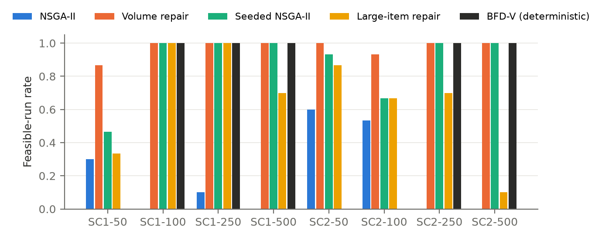
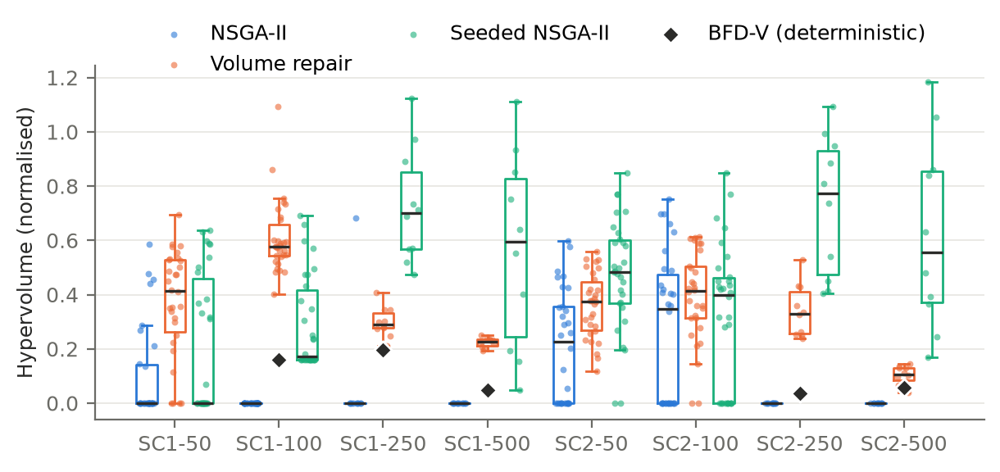
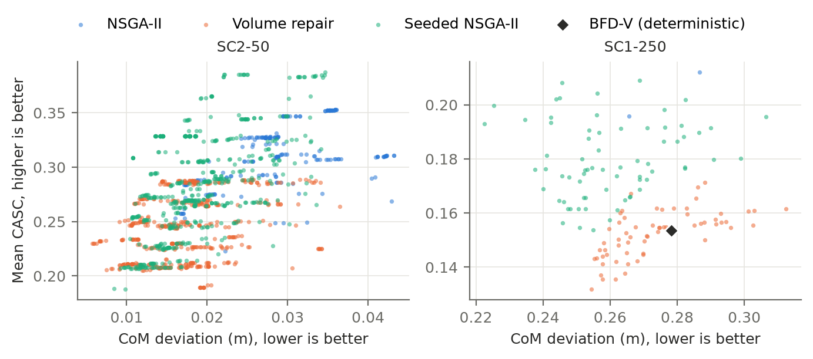

# Feasibility Decides the Trade-off: Injecting a Constructive Prior into Multi-Objective Spacecraft Payload Packing

**Authors:** [Author names, affiliations and contact details to be supplied by the authors]

## Abstract

Stowing cargo in a spacecraft logistics module couples a three-dimensional packing problem with two conflicting goals: keeping the centre of mass (CoM) near its target and keeping items accessible to the crew. We study this as bi-objective search with NSGA-II over packing sequences and orientations, decoded by an Extreme Point heuristic, on twelve synthetic instances of 50 to 500 items. All methods are compared under a matched evaluation budget, with seed-paired tests and Holm correction, in about 1,400 runs.

Plain NSGA-II rarely returns a valid packing. It finds one in at most 60% of seeds on any instance and in none on four of eight solvable instances. A decreasing-volume constructive order restores feasibility, and we compare two ways of injecting it.

- **Baldwinian repair.** Failed chromosomes are re-decoded in volume order. This makes the search feasible in 87–100% of seeds and gives the highest hypervolume on the 50- and 100-item SC1 instances.
- **Seeding.** One best-fit-decreasing solution is placed in the initial population. This is significantly better than the repair on three instances (SC1-250, SC2-50 and SC2-500, Holm p ≤ 0.022) and better in mean on two more. It needs half the decoder calls.

Among seeds where both methods are feasible, the repair produces lower CoM deviation but lower accessibility than plain NSGA-II. It shifts the front rather than improving it. Seeding improves both objectives over the repair on the large instances.

An ablation shows the gain comes from the volume order itself. With a contact constraint that forbids floating items, feasibility drops and the ranking becomes instance-specific. No method found a valid packing on the 96%-utilisation scenario. We conclude that evaluations of packing optimisers should report feasibility separately from front quality, include strong constructive baselines, and treat the way a prior is injected as a design choice with a measurable effect on the trade-off.

**Keywords:** spacecraft logistics; three-dimensional packing; multi-objective evolutionary algorithms; constraint handling; repair; population seeding; NSGA-II; hypervolume

## 1. Introduction

Cargo for a crewed spacecraft must be packed so that the vehicle's centre of mass stays within tolerance. It must also remain retrievable by a crew who reach in through an access face and may have to remove items to reach the one they need. The two goals conflict. Compact packings that keep the CoM on target tend to bury items, and accessible packings tend to load mass unevenly. Multi-objective evolutionary algorithms (MOEAs) suit this problem because they return a set of compromises rather than a single packing.

A decoder-based MOEA searches over packing sequences and orientations, and a placement heuristic converts each chromosome into a layout. This design is standard in container loading (Gonçalves and Resende, 2013), but it has a weakness that is easy to overlook. The decoder may fail to place every item, so a chromosome can describe an invalid packing. Constrained-domination selection (Deb, 2000; Deb et al., 2002) steers the search toward feasibility but does not guarantee it. An evaluation that then compares fronts without separating feasibility either compares invalid layouts or silently rewards whichever method finds any valid one.

Constructive heuristics such as best-fit-decreasing by volume handle feasibility well but return a single layout. An obvious remedy is to inject the constructive order into the MOEA. The order can be inserted at decoding time, by repairing chromosomes that fail (Salcedo-Sanz, 2009), or at initialisation, by seeding the population with the heuristic's solution (Friedrich and Wagner, 2015). This paper asks whether these remedies work for CoM–accessibility packing, why, and at what cost to the trade-off. The contributions are:

1. **An evaluation protocol that separates feasibility from front quality.** It uses matched evaluation budgets, pooled feasible reference fronts, feasible-run rates, and seed-paired tests with family-wise correction. A separate analysis compares methods only on seeds where both are feasible (Sections 4 and 6.1).
2. **A comparison of two ways to inject the same constructive prior,** a Baldwinian volume-ordered repair and a single seeded individual, against plain NSGA-II, random search and three deterministic heuristics. The study covers eight solvable instances with up to 500 items (Section 6.1). Seeding wins at scale, and repair wins on small instances.
3. **Evidence on where the gain comes from and what it costs.** The feasibility-conditioned analysis shows that the repair shifts solutions toward CoM compactness at the expense of accessibility (Section 6.3). The ablation attributes the gain to the volume order and shows orientation search is essential (Section 6.5). A contact-constrained decoder shows how the conclusions change when items may not float (Section 6.6). A sensitivity analysis shows that the main comparison is robust to the accessibility constants (Section 6.4).
4. **A corrected and tested batched GPU scorer.** The original scorer treated padding rows as items and so biased the accessibility objective of every infeasible layout. The corrected version scores 4–6× faster than the CPU reference (Section 6.7).

We do not validate the accessibility surrogate against crew data, model launch loads, or claim a whole-run GPU speedup. Section 8 states these limits.

## 2. Related Work

**Container loading.** Bischoff and Ratcliff (1995) set out the practical issues that distinguish container loading from abstract packing. Bortfeldt and Wäscher (2013) review the constraints that arise in practice, including weight distribution, stability, orientation, loading priorities and positioning. In their terms, our CoM objective is a weight-distribution criterion and our accessibility objective is a positioning criterion. Davies and Bischoff (1999) give an early treatment of weight distribution in container loading. Ramos, Oliveira, Gonçalves and Lopes (2016) enforce static mechanical equilibrium, a stricter stability model than the contact constraint we test. Ceschia and Schaerf (2013) address multi-drop loading, where items must be reachable in delivery order, an accessibility requirement related to ours. Zhao, Bennell, Bektaş and Dowsland (2016) compare container loading algorithms on common benchmarks.

**Three-dimensional packing heuristics.** Martello, Pisinger and Vigo (2000) established exact and heuristic methods for three-dimensional bin packing. Crainic, Perboli and Tadei (2008) introduced Extreme Points (EP) as placement candidates, which our decoder uses. Parreño, Alvarez-Valdes, Tamarit and Oliveira (2008) use maximal spaces instead. Gonçalves and Resende (2013) encode a packing as a sequence and orientation vector decoded by a placement heuristic, with a biased random-key genetic algorithm. Our representation follows this decoder-based design.

**Space cargo.** Cargo accommodation for the International Space Station has been supported by an operational tool, CAST, which combines global optimisation with heuristics and balancing rules (Fasano, Lavopa, Negri and Vola, 2015). Fasano (2014) treats non-standard packing problems from this domain. Ho (2023) reviews space logistics optimisation at the campaign and network level. We found no study that pairs a CoM objective with an accessibility objective under an EP decoder and compares methods under a matched budget. This reflects our search, not a guarantee that none exists.

**Constraint handling, repair and seeding in evolutionary algorithms.** NSGA-II (Deb et al., 2002) handles constraints by constrained domination, which follows Deb's (2000) feasibility rules. Repair maps an infeasible solution to a feasible or less infeasible one. Salcedo-Sanz (2009) surveys repair methods as constraint-handling techniques. When the repaired phenotype is evaluated but not written back to the genotype, the repair is Baldwinian rather than Lamarckian (Whitley, Gordon and Mathias, 1994). Our repair is Baldwinian. Seeding inserts known good solutions into the initial population. Friedrich and Wagner (2015) show that it can speed up MOEAs considerably, and also that it can bias the final population. We use the pymoo implementation of NSGA-II (Blank and Deb, 2020).

**Evaluation methodology.** Hypervolume (Zitzler and Thiele, 1999) and the wider methodology of quality indicators (Zitzler, Thiele, Laumanns, Fonseca and da Fonseca, 2003) underpin our front comparisons. For comparing stochastic algorithms over several problems, we follow Derrac, García, Molina and Herrera (2011): per-problem nonparametric tests with a family-wise correction across problems, here the procedure of Holm (1979), and Cliff's (1993) δ as the effect size.

**GPU evaluation.** Özcan, Dokeroğlu, Coşar and Yazıcı (2016) run a grouping genetic algorithm for one-dimensional bin packing on a GPU. Our batched scorer addresses three-dimensional objectives and is reported only as a scoring-stage measurement.

## 3. Problem and Methods

### 3.1 Representation and decoder

A solution is a permutation σ of the N items together with an orientation vector o ∈ {1,…,6}ᴺ. Each orientation selects one of the six axis permutations of an item's width, depth and height.

The Extreme Point decoder places items in the order σ. Each item is tried, in its chosen orientation, at the current extreme points sorted by z, then y, then x. It goes at the first point where it lies inside the container and overlaps no placed item, and the extreme points are then updated. An item with no valid point is left unplaced.

The access face is the plane z = 0, and z is depth from that face. The decoder therefore fills the container from the access face inward. By default it does not require an item to touch the items nearer the access face. Section 6.6 studies a contact-constrained variant.

### 3.2 Constraints and objectives

A layout is feasible when every item is placed. The constraints are g₁ = total unplaced volume ≤ 0 and g₂ = number of unplaced items ≤ 0.

- **f₁, CoM deviation (minimise).** The Euclidean distance between the system centre of mass and a target point t = (0.5, 0.5, 1.0) m. The system includes a dry mass of 5000 kg located at t. Because t is absolute and container sides range from 1.37 to 3.17 m, Section 6.4 also tests a target at the container centre.
- **f₂, accessibility (maximise; implemented as minimising −CASC).** For each packed item i, CASC_i = exp(−c_i), with c_i = c_reach + c_occ + c_ext.
  - c_reach = (z_i / L_arm)² with L_arm = 0.75 m.
  - c_occ = λ(1 − v_i) with λ = 1, where v_i is the visible fraction of item i's footprint on a 10 × 10 grid, counting only items nearer the access face.
  - c_ext = Σ_j ρ_j (C_grasp + κ m_j) over the transitive blockers j of i, with C_grasp = 2, κ = 0.05 kg⁻¹, and ρ_j = 0.4 for consumable or waste items and 1 otherwise.

  The objective is the mean CASC over packed items.

A layout with no packed item receives f₁ = 9999 and f₂ = 0.

### 3.3 Optimiser

We use NSGA-II with constrained domination on (g₁, g₂). Population and generations are 100 and 100 for N ≤ 100, and 50 and 50 for N ≥ 250. The operators are:

- **Crossover:** OX1 order crossover on σ and uniform crossover on o (mask 0.5), applied with probability 0.9.
- **Mutation:** swap or inversion on σ, and reset on each orientation gene, each with probability 1/N.
- **Duplicates:** eliminated.

### 3.4 Injecting the volume-order prior

All three variants below change exactly one thing relative to plain NSGA-II.

**Volume repair (Baldwinian).** If decoding leaves an item unplaced, the chromosome is re-decoded with σ stably sorted by decreasing item volume and the same orientations. The decode with less unplaced volume is kept. The genotype is not modified.

```
evaluate(σ, o):
    layout ← EP-decode(σ, o)
    if layout leaves an item unplaced:
        layout' ← EP-decode(sort σ by decreasing volume, o)
        if unplaced-volume(layout') < unplaced-volume(layout): layout ← layout'
    return f₁, f₂, g₁, g₂ of layout          # σ and o are not changed
```

**Large-item repair.** As the volume repair, except that only items with volume at or above the instance median move to the front, in decreasing volume order. The smaller items keep their order from σ. The intent is to secure feasibility with the large items while leaving the search in control of where the small items go, and so of accessibility.

**Seeded NSGA-II.** Plain NSGA-II whose initial population contains one BFD-V chromosome: the decreasing-volume sequence with the orientations BFD-V chose (Section 3.5). The other individuals are random. The seed decodes to exactly the BFD-V layout, which a test verifies. Where BFD-V is infeasible, the seed is the BFD-V order that fails.

Each repair costs one or two decoder calls per evaluation. In practice the first decode almost always fails, so the repairs used 19,900–20,000 decoder calls per 10,000 evaluations. Seeding uses exactly as many decoder calls as plain NSGA-II.

### 3.5 Baselines

- **Plain NSGA-II.**
- **Random search,** with the same number of evaluations as NSGA-II on the same dataset and seed.
- **Three deterministic constructions** with the same EP decoder. Unlike the MOEA decode, these try all six rotations at each extreme point and take the first fit. First-Fit (FF) uses dataset order, BFD-V uses decreasing volume, and BFD-P uses decreasing priority.

## 4. Experimental Design

**Instances.** Twelve synthetic instances (HyperDock-Bench V1) with N ∈ {50, 100, 250, 500} and three scenarios:

- SC1 is consumable-heavy, at 80% volume utilisation.
- SC2 is safety-item-heavy (40%), at 80% utilisation.
- SC3 has the SC1 mix at 96% utilisation.

Item sizes follow cargo-transfer-bag classes plus an irregular class. Masses are lognormal by category, and each container is a cube sized to the target utilisation. Every instance is seeded from its identifier, and the committed generator reproduces all twelve files exactly. Distributions and per-instance statistics are in `docs/DATASETS.md`.

**Runs.** Each instance is run with each method on seeds 1–30 for N ∈ {50, 100} and seeds 1–10 for N ∈ {250, 500}. The seed reduction for the two largest sizes was a compute decision: a single N = 500 run takes 11 to 51 minutes depending on method and machine load. In total:

- 720 runs of NSGA-II, the volume repair and random search over all twelve instances, plus 320 runs of the seeded and large-item variants on the eight SC1 and SC2 instances, with 36 deterministic constructions;
- 120 ablation runs (Section 6.5);
- 204 contact-decoder runs (Section 6.6).

Every evaluated chromosome is archived, so comparisons use all evaluations, not only the final population. All objective values come from the CPU reference scorer.

**Platform.** A laptop with 28 logical CPU cores and an NVIDIA RTX 4050 Laptop GPU, running Python 3.12, pymoo 0.6.2, numpy 2.5.4, scipy 1.18.1 and numba 0.68.1.

**Metrics.**

- **Feasible-run rate:** the fraction of seeds with at least one feasible evaluation.
- **Hypervolume (HV):** for each instance, the feasible points of all methods and seeds are pooled, the objectives are min-max normalised on that pool, and HV is taken with reference point (1.1, 1.1). A run with no feasible point has HV 0. Because the pool includes every method, HV values are comparable within an instance and a study, but not across studies with different method sets.
- **IGD:** distance to the non-dominated pooled set, for feasible runs only.

**Statistics.** Each pair of methods is compared per instance with a two-sided Wilcoxon signed-rank test paired by seed. Effect size is Cliff's δ, and intervals are bootstrap 95% intervals of the mean (10,000 resamples). Holm correction is applied across instances within each comparison. Comparisons where both methods have HV 0 in every run, which covers all of SC3, are excluded from the family because no test is possible there. With n seeds, the smallest attainable p-value is 2/2ⁿ: 0.002 for 10 seeds and 1.9 × 10⁻⁹ for 30.

## 5. Implementation Correctness

**Batched-scorer defect.** A batched PyTorch scorer packs a population on the CPU and evaluates the accessibility objective on the GPU. It passed unplaced items as zero rows and scored them as real items at the origin, with errors up to about 0.1 in mean CASC. Fully packed layouts were unaffected, so an equivalence check on those passed, yet most layouts visited during search are partially packed. The corrected scorer masks padding rows and matches the CPU reference to within 8 × 10⁻⁸ on partially packed layouts. Regression tests cover that case. An earlier analysis of this system used the defective scorer and is withdrawn (Appendix A).

**Cross-environment reproducibility.** Pareto points from the laptop runs were re-decoded and re-scored in a separate Linux environment with different package versions, and the objective values were identical. The deterministic heuristics produced identical layouts in both environments. The test suite (47 tests) checks that the generic implementation of every variant reproduces the published methods exactly, and that the seeded chromosome decodes to the BFD-V layout.

## 6. Results

### 6.1 Feasibility and hypervolume



**Table 1.** Hypervolume, mean with bootstrap 95% interval, and feasible seeds per method. The reference front pools all methods. The best mean per row is in bold. The p-values are Holm-adjusted Wilcoxon tests across the eight instances.

| Instance | Seeds | NSGA-II | Volume repair | Seeded NSGA-II | Large-item repair | Repair vs NSGA-II | Seeded vs NSGA-II | Repair vs seeded |
|---|---|---|---|---|---|---|---|---|
| SC1-50 | 30 | 0.100 [0.042, 0.167] · 9 | **0.371** [0.300, 0.438] · 26 | 0.211 [0.125, 0.305] · 14 | 0.112 [0.054, 0.178] · 10 | 7.0 × 10⁻⁴ | 0.087 | 0.068 |
| SC1-100 | 30 | 0 · 0 | **0.608** [0.565, 0.659] · 30 | 0.291 [0.232, 0.354] · 30 | 0.498 [0.447, 0.547] · 30 | 1.5 × 10⁻⁸ | 1.1 × 10⁻⁵ | **1.3 × 10⁻⁶** (repair) |
| SC1-250 | 10 | 0.068 [0, 0.205] · 1 | 0.299 [0.268, 0.333] · 10 | **0.725** [0.608, 0.855] · 10 | 0.250 [0.196, 0.297] · 10 | 0.084 | 0.012 | **0.014** (seeded) |
| SC1-500 | 10 | 0 · 0 | 0.224 [0.213, 0.235] · 10 | **0.563** [0.358, 0.772] · 10 | 0.113 [0.062, 0.162] · 7 | 0.012 | 0.012 | 0.068 |
| SC2-50 | 30 | 0.210 [0.139, 0.286] · 18 | 0.360 [0.318, 0.402] · 30 | **0.474** [0.399, 0.545] · 28 | 0.303 [0.246, 0.361] · 26 | 0.012 | 1.1 × 10⁻⁴ | **0.022** (seeded) |
| SC2-100 | 30 | 0.270 [0.175, 0.366] · 16 | **0.391** [0.331, 0.449] · 28 | 0.322 [0.230, 0.415] · 20 | 0.343 [0.245, 0.441] · 20 | 0.077 | 0.33 | 0.29 |
| SC2-250 | 10 | 0 · 0 | 0.341 [0.288, 0.400] · 10 | **0.727** [0.576, 0.880] · 10 | 0.181 [0.093, 0.269] · 7 | 0.012 | 0.012 | 0.055 |
| SC2-500 | 10 | 0 · 0 | 0.104 [0.082, 0.123] · 10 | **0.622** [0.421, 0.829] · 10 | 0.064 [0, 0.193] · 1 | 0.012 | 0.012 | **0.014** (seeded) |

**Feasibility.** Plain NSGA-II returns a valid packing in at most 60% of seeds, and in none on SC1-100, SC1-500, SC2-250 and SC2-500. Random search never does. Both ways of injecting the volume order fix this on most instances. The volume repair is feasible in 87–100% of seeds everywhere. Seeding is feasible in every seed on the instances where its seed is itself feasible (SC1-100, SC1-250, SC1-500, SC2-250, SC2-500). Where the seed is infeasible, seeding still raises the feasible rate above plain NSGA-II on every instance (SC1-50: 14 against 9; SC2-50: 28 against 18; SC2-100: 20 against 16).

**Front quality.** After Holm correction:

- The repair beats plain NSGA-II on six of eight instances, and seeding on six of eight.
- Between the two priors, the repair is significantly better on SC1-100 (δ = 0.81).
- Seeding is significantly better on SC1-250, SC2-50 and SC2-500 (|δ| ≥ 0.39), and better in mean but not significantly so on SC1-500 and SC2-250 (Holm p = 0.068 and 0.055).
- Neither is significantly better on SC1-50 or SC2-100.

The large-item repair is never the best method. It is significantly worse than the volume repair on SC1-50 and SC1-500, and less often feasible on the largest instances.



### 6.2 Deterministic heuristics

**Table 2.** Items packed by the deterministic heuristics (one run each). An instance is feasible only if all N items are packed. HV is on the Table 1 reference front.

| Instance | N | FF | BFD-V | BFD-P | BFD-V HV | Best MOEA HV |
|---|---|---|---|---|---|---|
| SC1-50 | 50 | 49 | 47 | 49 | infeasible | 0.371 |
| SC1-100 | 100 | 97 | **100** | 97 | 0.160 | 0.608 |
| SC1-250 | 250 | 248 | **250** | 248 | 0.197 | 0.725 |
| SC1-500 | 500 | 499 | **500** | 494 | 0.047 | 0.563 |
| SC2-50 | 50 | 49 | 49 | 48 | infeasible | 0.474 |
| SC2-100 | 100 | 99 | 93 | 98 | infeasible | 0.391 |
| SC2-250 | 250 | 246 | **250** | 245 | 0.036 | 0.727 |
| SC2-500 | 500 | 498 | **500** | 497 | 0.058 | 0.622 |
| SC3-50 / 100 / 250 / 500 | — | 45 / 91 / 202 / 459 | 38 / 82 / 187 / 382 | 48 / 88 / 228 / 452 | infeasible | infeasible |

BFD-V is feasible on five instances, and the best MOEA variant exceeds its hypervolume on every one of them. On SC1-50, SC2-50 and SC2-100, the MOEA variants find valid packings that none of the three heuristics finds. On SC3 no method packs every item. Because the generator controls volume, not packability, whether complete packings exist there is unknown.

### 6.3 What the prior does to the trade-off

Table 1 compares runs that differ in feasibility. Table 3 restricts each comparison to seeds on which both methods are feasible, and compares the hypervolume and the best value each run reaches on each objective.

**Table 3.** Seeds where both methods are feasible. Each cell gives the means for the two methods in the order named in the comparison column. The best values are the per-run minimum CoM deviation (m) and maximum mean CASC, averaged over these seeds. p is a seed-paired Wilcoxon test.

| Instance | Comparison | Seeds | HV (p) | Best CoM deviation (p) | Best CASC (p) |
|---|---|---|---|---|---|
| SC1-50 | repair vs NSGA-II | 8 | 0.389 / 0.349 (0.64) | **0.019** / 0.032 (0.008) | 0.257 / **0.304** (0.016) |
| SC2-50 | repair vs NSGA-II | 18 | 0.338 / 0.350 (0.80) | **0.014** / 0.027 (8 × 10⁻⁶) | 0.230 / **0.286** (2.5 × 10⁻⁴) |
| SC2-100 | repair vs NSGA-II | 14 | 0.459 / 0.515 (0.30) | **0.056** / 0.071 (6 × 10⁻⁴) | 0.212 / **0.248** (6 × 10⁻⁴) |
| SC2-50 | seeded vs NSGA-II | 16 | **0.579** / 0.349 (4 × 10⁻⁴) | **0.014** / 0.027 (3 × 10⁻⁵) | 0.234 / **0.285** (0.001) |
| SC1-50 | repair vs seeded | 12 | 0.410 / 0.438 (0.79) | **0.019** / 0.027 (0.005) | 0.254 / **0.302** (0.003) |
| SC1-100 | repair vs seeded | 30 | **0.608** / 0.291 (2 × 10⁻⁷) | **0.057** / 0.063 (3 × 10⁻⁴) | **0.189** / 0.176 (1 × 10⁻⁴) |
| SC1-250 | repair vs seeded | 10 | 0.299 / **0.725** (0.002) | 0.261 / **0.243** (0.002) | 0.143 / **0.170** (0.002) |
| SC1-500 | repair vs seeded | 10 | 0.224 / **0.563** (0.027) | 0.689 / 0.673 (0.23) | 0.102 / **0.126** (0.004) |
| SC2-250 | repair vs seeded | 10 | 0.341 / **0.727** (0.014) | 0.243 / **0.230** (0.027) | 0.129 / **0.140** (0.027) |
| SC2-500 | repair vs seeded | 10 | 0.104 / **0.622** (0.002) | 0.658 / **0.589** (0.002) | 0.092 / **0.125** (0.002) |
| SC2-100 | large-item vs volume repair | 19 | **0.528** / 0.410 (0.011) | 0.069 / **0.058** (1 × 10⁻⁵) | **0.253** / 0.208 (1 × 10⁻⁴) |

Three findings follow.

- **The repair shifts the front; it does not improve it.** On every instance where enough seeds are feasible for both methods, the repair's hypervolume is indistinguishable from plain NSGA-II's. The repair reaches significantly lower CoM deviation and significantly lower accessibility. A plausible mechanism: re-decoding from largest to smallest places the largest items first, at the access face. That keeps mass compact but buries small items behind large blockers.
- **Seeding improves the front at scale.** For N ≥ 250, seeded NSGA-II beats the repair on both objectives, significantly so in seven of eight objective comparisons. On SC2-50 it also beats plain NSGA-II in conditional hypervolume. The repair forces the volume order onto every failed evaluation, whereas seeding offers the order once and lets selection and recombination decide how much of it to keep. On small instances, where the repair wins on CoM and seeding on accessibility, the two priors trade off rather than one dominating.
- **Partial ordering recovers accessibility at a cost in feasibility.** On SC2-100, the large-item repair recovers the accessibility the full repair gives up (CASC 0.253 against 0.208), with higher conditional hypervolume. It is feasible in fewer seeds (20 against 28), so its overall hypervolume in Table 1 is not higher.



### 6.4 Sensitivity to the objective definition

The CASC constants and the CoM target were chosen by hand. For the volume repair against plain NSGA-II, we re-decoded and re-scored every Pareto point of every run under nine changed settings: each of L_arm, λ, C_grasp and κ halved and doubled, and the CoM target and dry mass moved to the container centre. BFD-V was re-run under each setting, and the statistics were recomputed on the reference front of that comparison. With the original constants, the procedure reproduces the original statistics exactly.

**Table 4.** Robustness of the repair-against-NSGA-II comparison (eight instances).

| Setting | Repair has higher mean HV | Holm-significant (α = 0.05) | Repair above BFD-V (of 5) |
|---|---|---|---|
| Original | 8 | 7 | 5 |
| L_arm × 0.5 / × 2 | 8 / 8 | 6 / 7 | 5 / 5 |
| λ × 0.5 / × 2 | 8 / 8 | 7 / 7 | 5 / 5 |
| C_grasp × 0.5 / × 2 | 8 / 8 | 6 / 7 | 5 / 5 |
| κ × 0.5 / × 2 | 8 / 8 | 7 / 7 | 5 / 5 |
| CoM target at container centre | 7 | 6 | 5 |

The direction of the comparison does not change under any change to the accessibility constants. Moving the CoM target reverses one instance, SC2-50, where both methods are often feasible and the comparison depends on how CoM is defined. The significance counts in Table 4 come from the two-method study, whose reference front lacks the seeded runs, so they differ slightly from Table 1. The analysis re-scores existing fronts rather than re-optimising, so it tests the robustness of the evaluation, not of the search.

### 6.5 Ablation of the volume repair

Six one-component ablations of the volume repair were run on SC1-100 and SC2-100 with seeds 1–10. Each ablated run's front was re-scored with the full objective and compared with the full repair, paired by seed, with Holm correction across the six ablations. HV here uses a reference front pooled over the ablation study and is not comparable with Table 1.

**Table 5.** Ablation results: HV mean ± SD, feasible seeds out of 10, and Holm-adjusted p against the full repair.

| Variant | SC1-100 HV | Feas. | p | SC2-100 HV | Feas. | p |
|---|---|---|---|---|---|---|
| Full volume repair | 0.758 ± 0.152 | 10 | — | 0.390 ± 0.193 | 9 | — |
| Repair in random order | 0 | 0 | 0.012 | 0.195 ± 0.259 | 4 | 0.64 |
| No orientation search | 0.028 ± 0.089 | 1 | 0.012 | 0.024 ± 0.051 | 2 | 0.023 |
| Contact constraint | 0.391 ± 0.136 | 10 | 0.012 | 0.064 ± 0.202 | 1 | 0.039 |
| CASC without reach term | 0.774 ± 0.162 | 10 | 0.85 | 0.397 ± 0.194 | 9 | 1.0 |
| CASC without occlusion term | 0.695 ± 0.119 | 10 | 0.11 | 0.395 ± 0.183 | 9 | 1.0 |
| CASC without extraction term | 0.661 ± 0.090 | 10 | 0.17 | 0.371 ± 0.164 | 9 | 1.0 |

- **The order is what matters.** A repair that re-decodes in random order is no better than no repair: 0 and 4 feasible seeds, against plain NSGA-II's 0 and 16 of 30. The gain comes from the decreasing-volume prior, not from a second decoding attempt.
- **Orientation search is essential.** With orientations fixed, feasibility collapses to 1 and 2 seeds out of 10.
- **No single CASC term drives the search.** Removing any one term from the search objective does not significantly change the full-objective front on these instances. This says nothing about whether each term is a meaningful model of retrieval effort.

### 6.6 Contact-constrained packing

The default decoder lets an item sit with a gap between it and the items nearer the access face. Under a contact constraint, each item away from the access face must rest at least half its footprint on faces of items directly nearer the face. We re-ran all methods with this constraint on the four instances with N ≤ 100 (10 seeds each, 204 runs).

**Table 6.** Contact-constrained decoder: HV mean ± SD and feasible seeds out of 10. BFD-V uses the same contact rule. Random search was infeasible in every run.

| Instance | NSGA-II | Volume repair | Seeded NSGA-II | Large-item repair | BFD-V |
|---|---|---|---|---|---|
| SC1-50 | 0 · 0 | **0.161 ± 0.222** · 5 | 0.116 ± 0.264 · 2 | 0.020 ± 0.063 · 1 | infeasible |
| SC1-100 | 0 · 0 | **0.478 ± 0.144** · 10 | 0.267 ± 0.175 · 10 | 0.414 ± 0.315 · 9 | 0.185 |
| SC2-50 | 0.181 ± 0.214 · 5 | 0.206 ± 0.206 · 6 | **0.335 ± 0.095** · 10 | 0.141 ± 0.156 · 5 | 0.158 |
| SC2-100 | 0.171 ± 0.384 · 3 | 0.074 ± 0.234 · 1 | **0.240 ± 0.261** · 5 | 0.158 ± 0.264 · 3 | infeasible |

Contact sharply reduces feasibility for every method. Only on SC1-100 are both prior-injecting methods significantly better than plain NSGA-II (Holm p = 0.008 for each), and there the repair leads seeding (uncorrected p = 0.049, Holm 0.20). On SC2 seeding has the best mean, but with ten seeds no difference survives correction. The qualitative picture holds under the stricter physics: a constructive prior is needed for feasibility, and repair and seeding each win on different instances. The magnitudes do not hold, and the unconstrained results should not be read as predictions for a physically constrained packer.

### 6.7 Computational cost

The volume repair and the large-item repair use almost two decoder calls per evaluation. Seeded NSGA-II uses one, like plain NSGA-II. In the main study the volume repair took 1.6–1.75 times NSGA-II's wall-clock time on every instance. The seeded and large-item runs were executed later with more parallel workers, so their wall-clock times are not comparable and are not reported. Their decoder-call counts are exact. A time-matched comparison would give the single-decode methods about 1.7 times as many evaluations. That favours seeding further, and would not rescue plain NSGA-II, which is infeasible in every seed on four instances.

On an NVIDIA RTX 4050 Laptop GPU, the corrected batched scorer evaluates 50, 100 and 250 packed SC1-100 layouts in 0.016, 0.041 and 0.108 s, against 0.101, 0.227 and 0.449 s on the CPU. These are medians of five repeats after warm-up, giving speedups of 6.4×, 5.5× and 4.1×. Packing remains on the CPU, and the whole-run speedup was not measured.

## 7. Discussion

**Report feasibility before front quality.** Hypervolume against a feasible reference front assigns 0 to a run without a valid packing. A method that is often infeasible therefore loses even when its feasible fronts are as good. Table 1 alone would suggest that the volume repair finds better trade-offs than plain NSGA-II. Table 3 shows that it does not: it finds valid packings, and among valid packings it occupies a different region of the front. Evaluations of decoder-based packing MOEAs should report feasible-run rates and a feasibility-conditioned comparison alongside overall hypervolume.

**How the prior is injected matters.** The volume repair and seeding inject the same constructive knowledge, but the results differ sharply. The repair applies the order to every failed evaluation, so it overrides the search's own ordering whenever a packing would fail. Seeding supplies the order once, and the search can recombine it with other orderings. At scale, where the decoder almost always fails without help, overriding the search costs both objectives, and seeding wins on both. On small instances the repair's override is cheap and its CoM bias is an advantage in hypervolume. Practitioners should treat repair and seeding as alternatives to compare, not as interchangeable fixes. Seeding is also simpler and costs no extra decoding.

**Repairs carry a bias.** A decreasing-volume repair imports BFD-V's logic, which is why it restores feasibility and also why it trades accessibility for compactness. The large-item repair shows the bias can be reduced, at some cost in feasibility. Repairs and seeds whose order reflects accessibility, for example by placing frequently retrieved items nearest the access face, are a natural next step.

**Strong constructive baselines are necessary.** BFD-V alone is feasible on five instances where plain NSGA-II rarely or never is. A study comparing an MOEA only with random search, or with weak heuristics, would overstate the value of the search. In our data the MOEA variants add front quality over BFD-V on every instance where BFD-V is feasible, and find valid packings where it is not. The feasibility, though, comes from BFD-V's order.

**Check numerical equivalence on the layouts the search visits.** The scorer defect in Section 5 was invisible to an equivalence check on fully packed layouts and appeared only on the partially packed layouts that dominate search.

**Physics changes the numbers.** Under a contact constraint, feasibility drops for every method, and the leader varies by instance. Conclusions about which method wins should be re-established for any packer used in practice. The finding that a constructive prior is needed for feasibility survives.

## 8. Threats to Validity and Limitations

**Internal validity.**

- Seeds were reduced to 10 for N ≥ 250, and the ablation and contact studies use 10 seeds on four or fewer instances.
- Wall-clock times were taken under different parallel loads, so we compare decoder calls rather than time for the later methods.
- Hyperparameters were not tuned for any method.
- The deterministic heuristics are single runs and are compared descriptively.
- The sensitivity analysis re-scores existing fronts of the repair-against-NSGA-II comparison rather than re-optimising, and does not cover the seeded variant.
- Hypervolume values depend on the pooled method set, so they are compared only within a study.

**Construct validity.** CASC is an unvalidated surrogate for retrieval effort, and the CoM model is a rigid-body approximation with an absolute target. The main comparison is robust to the tested perturbations of both, but the trade-off has not been validated against crew or mission data.

**External validity.** The instances are synthetic rigid cuboids accessed from one face. Launch-load restraint, static equilibrium (Ramos et al., 2016), soft goods and lateral access are not modelled, and the contact study shows that stricter physics changes the results. Only one MOEA and one decoder family were studied.

**Reproducibility.** All code, instance files, derived results and figures are in the repository. Objective values were reproduced exactly in a second environment. The raw evaluation archives (about 1.6 GB) are regenerated by the commands below.

## 9. Conclusion

In a bi-objective CoM–accessibility packing model, plain NSGA-II with an EP decoder rarely returns a valid packing. Injecting a decreasing-volume constructive prior fixes this, through a Baldwinian repair or through a single seeded individual. Both beat plain NSGA-II in hypervolume on six of eight solvable instances, and both beat the deterministic BFD-V construction wherever it is feasible.

The two ways of injecting the prior are not equivalent. Seeding is better at scale, improving both objectives over the repair on the large instances at half the decoding cost. The repair is better on the smallest instances. The repair's gain over NSGA-II is a feasibility gain: among feasible runs it shifts the front toward CoM compactness at the expense of accessibility, rather than improving it. Ablation attributes the gain to the volume order, and a contact constraint reduces feasibility for every method without removing the need for a prior.

Evaluations of packing optimisers should report feasibility separately from front quality and include strong constructive baselines, and the way a prior is injected should be chosen and tested deliberately. The next steps are accessibility-aware priors, contact- and equilibrium-aware decoders, and validation of the surrogates against operational data.

## Reproducibility Statement

The code, instances and analysis scripts are in the project repository. The derived data behind every table and figure are in `docs/paper/data/`: per-run metrics, extracted Pareto fronts, and the sensitivity, ablation and contact results. The test suite (`pytest tests`) covers the scorer correction, every method variant, the seeded chromosome, the contact decoder and the ablation decoders. Run from the repository root:

```
# Main study (NSGA-II, volume repair, random search; 12 instances)
python experiments/matched_budget_runner.py \
    --datasets SC1-50 SC2-50 SC3-50 SC1-100 SC2-100 SC3-100 \
    --seeds 1 ... 30 --out experiments/full_matched
python experiments/matched_budget_runner.py \
    --datasets SC1-250 SC2-250 SC3-250 SC1-500 SC2-500 SC3-500 \
    --seeds 1 ... 10 --out experiments/full_matched
python experiments/heuristic_baselines.py --out experiments/full_matched

# Seeded and large-item variants; contact-decoder study
python experiments/extended_runner.py --stage new_methods --workers 14
python experiments/extended_runner.py --stage contact --workers 14

# Analysis
python experiments/matched_budget_analysis.py --dir experiments/full_matched
python experiments/matched_budget_analysis.py --dir experiments/contact
python experiments/conditional_analysis.py \
    --metrics experiments/full_matched/per_run_metrics.csv

# Sensitivity, ablation, figures (D = docs/paper/data)
python experiments/sensitivity_rescore.py \
    --fronts $D/fronts_full_matched.npz --out experiments/sensitivity
python experiments/ablation_study.py --datasets SC1-100 SC2-100 \
    --seeds 1 2 3 4 5 6 7 8 9 10 --workers 12
python experiments/ablation_analysis.py --ablation experiments/ablation \
    --fronts $D/fronts_full_matched.npz
python experiments/paper_figures.py --metrics $D/v7/per_run_metrics.csv \
    --fronts $D/v7/fronts_v7.npz --baselines experiments/full_matched

# Scoring-stage GPU timing (CUDA device required)
python experiments/benchmark_gpu_v2.py
```

## Appendix A. Relation to an earlier analysis of this system

An earlier version of this work reported that NSGA-II significantly outperformed single-construction heuristics in hypervolume, and claimed a whole-run GPU speedup. Those results are withdrawn, for four reasons:

1. They were computed with the defective batched scorer (Section 5), which biased the accessibility objective for every infeasible layout.
2. Most reported solutions were infeasible.
3. The significance test compared 30 stochastic hypervolumes with a single fixed baseline value. That test asks whether every run exceeds the value, not whether the methods differ.
4. The GPU benchmark timed packing and scoring together, including start-up, and its equivalence check compared empty outputs.

This paper replaces those analyses with the protocol of Section 4 and the scoring-stage measurement of Section 6.7.

## References

- Bischoff, E. E., and Ratcliff, M. S. W. (1995). Issues in the development of approaches to container loading. *Omega*, 23(4), 377–390.
- Blank, J., and Deb, K. (2020). pymoo: Multi-objective optimization in Python. *IEEE Access*, 8. DOI 10.1109/ACCESS.2020.2990567.
- Bortfeldt, A., and Wäscher, G. (2013). Constraints in container loading – a state-of-the-art review. *European Journal of Operational Research*, 229(1), 1–20. DOI 10.1016/j.ejor.2012.12.006.
- Ceschia, S., and Schaerf, A. (2013). Local search for a multi-drop multi-container loading problem. *Journal of Heuristics*, 19(2), 275–294. DOI 10.1007/s10732-011-9162-6.
- Cliff, N. (1993). Dominance statistics: Ordinal analyses to answer ordinal questions. *Psychological Bulletin*, 114(3), 494–509. DOI 10.1037/0033-2909.114.3.494.
- Crainic, T. G., Perboli, G., and Tadei, R. (2008). Extreme point-based heuristics for three-dimensional bin packing. *INFORMS Journal on Computing*, 20(3), 368–384. DOI 10.1287/ijoc.1070.0250.
- Davies, A. P., and Bischoff, E. E. (1999). Weight distribution considerations in container loading. *European Journal of Operational Research*, 114(3), 509–527.
- Deb, K. (2000). An efficient constraint handling method for genetic algorithms. *Computer Methods in Applied Mechanics and Engineering*, 186(2–4), 311–338. DOI 10.1016/S0045-7825(99)00389-8.
- Deb, K., Pratap, A., Agarwal, S., and Meyarivan, T. (2002). A fast and elitist multiobjective genetic algorithm: NSGA-II. *IEEE Transactions on Evolutionary Computation*, 6(2), 182–197. DOI 10.1109/4235.996017.
- Derrac, J., García, S., Molina, D., and Herrera, F. (2011). A practical tutorial on the use of nonparametric statistical tests as a methodology for comparing evolutionary and swarm intelligence algorithms. *Swarm and Evolutionary Computation*, 1(1), 3–18. DOI 10.1016/j.swevo.2011.02.002.
- Fasano, G. (2014). *Solving Non-standard Packing Problems by Global Optimization and Heuristics*. SpringerBriefs in Optimization. Springer. DOI 10.1007/978-3-319-05005-8.
- Fasano, G., Lavopa, C., Negri, D., and Vola, M. C. (2015). CAST: A successful project in support of the International Space Station logistics. In *Optimized Packings with Applications*, Springer Optimization and Its Applications, 87–117. DOI 10.1007/978-3-319-18899-7_5.
- Friedrich, T., and Wagner, M. (2015). Seeding the initial population of multi-objective evolutionary algorithms: A computational study. *Applied Soft Computing*, 33, 223–230. DOI 10.1016/j.asoc.2015.04.043.
- Gonçalves, J. F., and Resende, M. G. C. (2013). A biased random key genetic algorithm for 2D and 3D bin packing problems. *International Journal of Production Economics*, 145(2), 500–510. DOI 10.1016/j.ijpe.2013.04.019.
- Ho, K. (2023). Space logistics modeling and optimization: Review of the state of the art. arXiv:2306.01107. DOI 10.2514/1.A35982.
- Holm, S. (1979). A simple sequentially rejective multiple test procedure. *Scandinavian Journal of Statistics*, 6(2), 65–70.
- Martello, S., Pisinger, D., and Vigo, D. (2000). The three-dimensional bin packing problem. *Operations Research*, 48(2), 256–267. DOI 10.1287/opre.48.2.256.12386.
- Özcan, S. O., Dokeroğlu, T., Coşar, A., and Yazıcı, A. (2016). A novel grouping genetic algorithm for the one-dimensional bin packing problem on GPU. In *Computer and Information Sciences (ISCIS 2016)*. DOI 10.1007/978-3-319-47217-1_6.
- Parreño, F., Alvarez-Valdes, R., Tamarit, J. M., and Oliveira, J. F. (2008). A maximal-space algorithm for the container loading problem. *INFORMS Journal on Computing*, 20(3), 412–422. DOI 10.1287/ijoc.1070.0254.
- Ramos, A. G., Oliveira, J. F., Gonçalves, J. F., and Lopes, M. P. (2016). A container loading algorithm with static mechanical equilibrium stability constraints. *Transportation Research Part B: Methodological*, 91, 565–581. DOI 10.1016/j.trb.2016.06.003.
- Salcedo-Sanz, S. (2009). A survey of repair methods used as constraint handling techniques in evolutionary algorithms. *Computer Science Review*. DOI 10.1016/j.cosrev.2009.07.001.
- Whitley, D., Gordon, V. S., and Mathias, K. (1994). Lamarckian evolution, the Baldwin effect and function optimization. In *Parallel Problem Solving from Nature – PPSN III*, LNCS 866. Springer. DOI 10.1007/3-540-58484-6_245.
- Zhao, X., Bennell, J. A., Bektaş, T., and Dowsland, K. (2016). A comparative review of 3D container loading algorithms. *International Transactions in Operational Research*, 23(1–2), 287–320. DOI 10.1111/itor.12094.
- Zitzler, E., and Thiele, L. (1999). Multiobjective evolutionary algorithms: A comparative case study and the strength Pareto approach. *IEEE Transactions on Evolutionary Computation*, 3(4), 257–271. DOI 10.1109/4235.797969.
- Zitzler, E., Thiele, L., Laumanns, M., Fonseca, C. M., and da Fonseca, V. G. (2003). Performance assessment of multiobjective optimizers: An analysis and review. *IEEE Transactions on Evolutionary Computation*, 7(2), 117–132. DOI 10.1109/TEVC.2003.810758.
