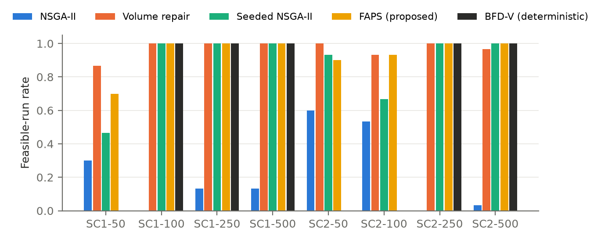
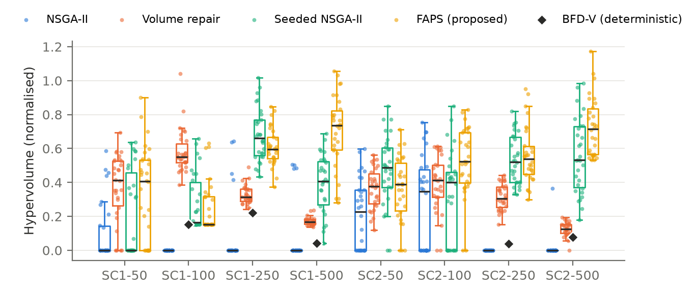
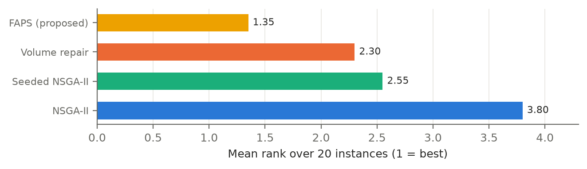
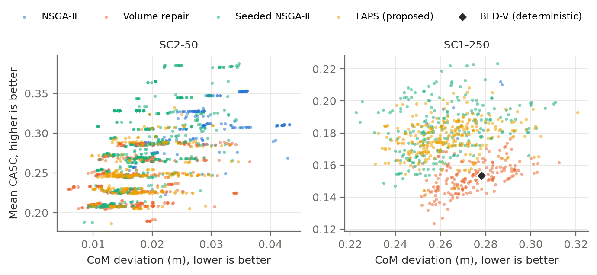
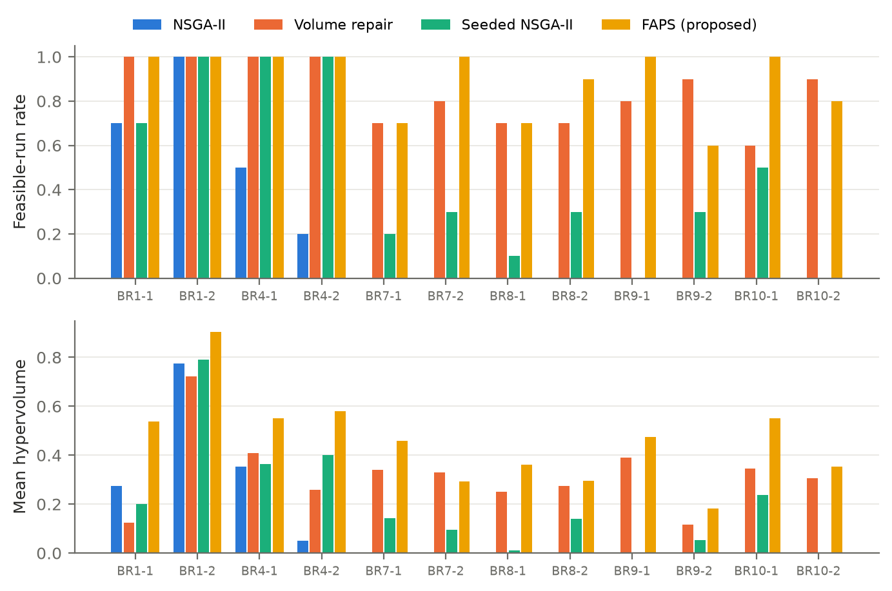

# Feasibility-Adaptive Portfolio Seeding for Multi-Objective Spacecraft Payload Packing

**Authors:** [Author names, affiliations and contact details to be supplied by the authors]

## Abstract

Stowing cargo in a spacecraft logistics module couples a three-dimensional packing problem with two conflicting goals: keeping the centre of mass (CoM) near its target and keeping items accessible to the crew. Decoder-based multi-objective evolutionary algorithms are a natural fit, but we show that on heterogeneous cargo they rarely return a valid packing at all. Plain NSGA-II succeeds in at most 4 of 30 seeds on five of eight synthetic instances, and never on Bischoff–Ratcliff instances with 20 or more box types. Its apparent front quality is therefore largely a statement about feasibility.

Two standard remedies inject a constructive packing order. A decreasing-volume Baldwinian repair restores feasibility but biases solutions toward compactness at the expense of accessibility. Seeding a single constructive solution preserves front quality, but fails when the constructive solution is itself infeasible. Neither is uniformly best, and on near-homogeneous cargo both can do worse than no prior at all.

We propose **feasibility-adaptive portfolio seeding (FAPS)**. It seeds the population with best-fit-decreasing constructions under four orders, and holds the repair in reserve until the search has found no valid packing within 10% of its generations. We evaluate FAPS against plain NSGA-II, the repair, single seeding, random search and three deterministic heuristics on 20 instances: eight synthetic ones with 50–500 items and 30 seeds each, and twelve adapted from the Bischoff–Ratcliff benchmark, classes BR1–BR10. The evaluation uses matched evaluation budgets and about 3,100 runs.

FAPS has the best mean rank (1.35 against 2.30–3.80; Friedman p = 4.5 × 10⁻⁸). It has a higher mean hypervolume than every competitor on 16 to 20 of the 20 instances, and it is significantly worse than a competitor on only one. Among seeds where both methods are feasible, it removes the repair's accessibility penalty. The findings hold under a second optimiser, SMS-EMOA, and under perturbed objective constants. We also report what does not hold, including a contact-constrained decoder that lowers feasibility for every method. We argue that evaluations of packing optimisers should report feasibility separately from front quality.

**Keywords:** spacecraft logistics; three-dimensional packing; container loading; multi-objective evolutionary algorithms; constraint handling; population seeding; repair; hypervolume

## 1. Introduction

Cargo for a crewed spacecraft must be packed so that the vehicle's centre of mass stays within tolerance. It must also stay retrievable by a crew who reach in through an access face and may have to remove items to reach the one they need. The two goals conflict. Compact packings that keep the CoM on target tend to bury items, and accessible packings tend to load mass unevenly. Multi-objective evolutionary algorithms (MOEAs) suit this problem because they return a set of compromises rather than a single packing.

A decoder-based MOEA searches over packing sequences and orientations, and a placement heuristic converts each chromosome into a layout. This design is standard in container loading (Gonçalves and Resende, 2013), but it has a weakness that is easy to overlook. The decoder may fail to place every item, so a chromosome can describe an invalid packing. Constrained-domination selection (Deb, 2000; Deb et al., 2002) steers the search toward feasibility but does not guarantee it. We find that for heterogeneous cargo it usually fails. An evaluation that compares fronts without separating feasibility then compares invalid layouts, or rewards whichever method finds any valid one.

Constructive heuristics such as best-fit-decreasing by volume handle feasibility well but return a single layout. Their order can be injected into the MOEA at decoding time, by repairing failed chromosomes (Salcedo-Sanz, 2009), or at initialisation, by seeding the population (Friedrich and Wagner, 2015). We show that both remedies work in some regimes and fail in others:

- **Repair** restores feasibility everywhere, but shifts the front toward CoM compactness at the expense of accessibility.
- **Seeding** produces better fronts when the seed is feasible, and does little when it is not.
- **On near-homogeneous cargo,** both can be worse than no prior at all.

These observations motivate a method that adapts to the instance. The contributions of this paper are:

1. **Feasibility-adaptive portfolio seeding (FAPS)** (Section 3.5). It seeds NSGA-II with constructive solutions under several orders and activates a volume-ordered repair only if the search finds no valid packing early on. On 20 instances, FAPS has the best mean rank and is significantly worse than a competitor on only one instance (Section 6.2).
2. **A diagnosis of why the standard remedies fall short** (Sections 6.1, 6.3 and 6.4):
   - On seeds where both methods are feasible, the repair does not improve hypervolume; it moves the front.
   - Single seeding wins at scale but fails when its seed is infeasible.
   - On a public benchmark, the value of any prior depends on cargo heterogeneity.
3. **An evaluation protocol that separates feasibility from front quality** (Section 4). It uses matched evaluation budgets, feasible-run rates, pooled feasible reference fronts, seed-paired tests with family-wise correction, and a comparison restricted to seeds on which both methods are feasible. It also includes an instance-level Friedman test, a second optimiser, an ablation, a sensitivity analysis and a contact-constrained decoder.
4. **A corrected and tested batched GPU scorer** (Sections 5 and 6.9). The original scorer treated padding rows as items, which biased the accessibility objective of every infeasible layout.

We do not validate the accessibility surrogate against crew data or model launch loads. Section 8 states these and other limits.

## 2. Related Work

**Container loading.** Bischoff and Ratcliff (1995) set out the practical issues that distinguish container loading from abstract packing, and introduced the benchmark we adapt in Section 6.4. Bortfeldt and Wäscher (2013) review the constraints that arise in practice, including weight distribution, stability, orientation, loading priorities and positioning. In their terms, our CoM objective is a weight-distribution criterion and our accessibility objective is a positioning criterion. Davies and Bischoff (1999) give an early treatment of weight distribution and used the extended Bischoff–Ratcliff classes. Ramos, Oliveira, Gonçalves and Lopes (2016) enforce static mechanical equilibrium, a stricter stability model than the contact constraint we test. Ceschia and Schaerf (2013) address multi-drop loading, where items must be reachable in delivery order, an accessibility requirement related to ours. Zhao, Bennell, Bektaş and Dowsland (2016) compare container loading algorithms on common benchmarks.

**Three-dimensional packing heuristics.** Martello, Pisinger and Vigo (2000) established exact and heuristic methods for three-dimensional bin packing. Crainic, Perboli and Tadei (2008) introduced Extreme Points (EP) as placement candidates, which our decoder uses. Parreño, Alvarez-Valdes, Tamarit and Oliveira (2008) use maximal spaces instead. Gonçalves and Resende (2013) encode a packing as a sequence and an orientation vector decoded by a placement heuristic, evolved with a biased random-key genetic algorithm. Our representation follows this decoder-based design.

**Space cargo.** Cargo accommodation for the International Space Station has been supported by an operational tool, CAST, which combines global optimisation with heuristics and balancing rules (Fasano, Lavopa, Negri and Vola, 2015). Fasano (2014) treats non-standard packing problems from this domain. Ho (2023) reviews space logistics optimisation at the campaign and network level. We found no study that pairs a CoM objective with an accessibility objective under an EP decoder and compares methods under a matched budget. This reflects our search, not a guarantee that none exists.

**Constraint handling, repair and seeding.** NSGA-II (Deb et al., 2002) handles constraints by constrained domination, following Deb's (2000) feasibility rules. Repair maps an infeasible solution to a feasible or less infeasible one, and Salcedo-Sanz (2009) surveys repair methods as constraint-handling techniques. When the repaired phenotype is evaluated but not written back to the genotype, the repair is Baldwinian rather than Lamarckian (Whitley, Gordon and Mathias, 1994). Seeding inserts known good solutions into the initial population. Friedrich and Wagner (2015) show that it can speed up MOEAs considerably, and also that it can bias the final population. FAPS combines a portfolio of seeds with a repair that is activated only on evidence of infeasibility. We use the pymoo implementations of NSGA-II and SMS-EMOA (Blank and Deb, 2020).

**Evaluation methodology.** Hypervolume (Zitzler and Thiele, 1999) and the wider methodology of quality indicators (Zitzler, Thiele, Laumanns, Fonseca and da Fonseca, 2003) underpin our front comparisons. For comparing stochastic algorithms over several problems we follow Derrac, García, Molina and Herrera (2011): per-problem nonparametric tests with a family-wise correction, here Holm's (1979) procedure, together with a Friedman test on mean ranks over problems. Cliff's (1993) δ serves as the effect size.

**GPU evaluation.** Özcan, Dokeroğlu, Coşar and Yazıcı (2016) run a grouping genetic algorithm for one-dimensional bin packing on a GPU. Our batched scorer addresses three-dimensional objectives and is reported only as a scoring-stage measurement.

## 3. Problem and Methods

### 3.1 Representation and decoder

A solution is a permutation σ of the N items together with an orientation vector o ∈ {1,…,6}ᴺ. Each orientation selects one of the six axis permutations of an item's width, depth and height. Where an item may use only some orientations (Section 6.4), the gene indexes the permitted ones cyclically. With all six permitted, the gene maps to itself.

The Extreme Point decoder places items in the order σ. Each item is tried, in its chosen orientation, at the current extreme points sorted by z, then y, then x. It is placed at the first point where it lies inside the container and overlaps no placed item, and the extreme points are then updated. An item with no valid point is left unplaced.

The access face is the plane z = 0, and z is depth from that face, so the decoder fills the container from the access face inward. By default an item need not touch the items nearer the access face. Section 6.7 studies a contact-constrained variant.

### 3.2 Constraints and objectives

A layout is feasible when every item is placed. The constraints are g₁ = total unplaced volume ≤ 0 and g₂ = number of unplaced items ≤ 0.

**f₁, CoM deviation (minimise).** The Euclidean distance between the system centre of mass and a target point t. The system includes a dry mass of 5000 kg located at t. On the synthetic instances t = (0.5, 0.5, 1.0) m; Section 6.8 also tests a target at the container centre. On the Bischoff–Ratcliff instances t is the container centre.

**f₂, accessibility (maximise; implemented as minimising −CASC).** For each packed item i, CASC_i = exp(−c_i), with c_i = c_reach + c_occ + c_ext:

- **Reach:** c_reach = (z_i / L_arm)² with L_arm = 0.75 m.
- **Occlusion:** c_occ = λ(1 − v_i) with λ = 1, where v_i is the visible fraction of item i's footprint on a 10 × 10 grid, counting only items nearer the access face.
- **Extraction:** c_ext = Σ_j ρ_j (C_grasp + κ m_j), summed over the transitive blockers j of item i, with C_grasp = 2, κ = 0.05 kg⁻¹, and ρ_j = 0.4 for consumable or waste items and 1 otherwise.

The objective is the mean CASC over packed items. A layout with no packed item receives f₁ = 9999 and f₂ = 0.

### 3.3 Optimisers

**NSGA-II.** We use NSGA-II with constrained domination on (g₁, g₂). Population and generations are 100 and 100 for N ≤ 121, and 50 and 50 for N ≥ 250. The operators are:

- **Crossover:** OX1 order crossover on σ and uniform crossover on o (mask 0.5), applied with probability 0.9.
- **Mutation:** swap or inversion on σ, and reset on each orientation gene, each with probability 1/N.
- **Duplicates:** eliminated.

**SMS-EMOA.** Section 6.5 uses SMS-EMOA with the same operators, population and generations. It differs from NSGA-II only in its survival rule: least hypervolume contribution among feasible solutions, and constraint violation among infeasible ones.

### 3.4 Constructive priors used as baselines

- **Volume repair (Baldwinian).** If decoding leaves an item unplaced, the chromosome is re-decoded with σ stably sorted by decreasing item volume and the same orientations. The decode with less unplaced volume is kept, and the genotype is not modified.
- **Seeded NSGA-II.** The initial population contains one BFD-V chromosome: the decreasing-volume sequence with the orientations that BFD-V chose. A test verifies that it decodes to exactly the BFD-V layout. The rest of the population is random.
- **Large-item repair** (Section 6.3 only). As the volume repair, but only items at or above the median volume move to the front. The smaller items keep their order from σ.

### 3.5 Feasibility-adaptive portfolio seeding (FAPS)

FAPS starts from the two observations above. The constructive order is what restores feasibility (Section 6.6), but forcing it on every failed evaluation distorts the trade-off (Section 6.3). A single seed is valuable when it is feasible and of little use otherwise. FAPS therefore supplies several constructive orders as seeds, and keeps the repair as a fallback:

```
FAPS(instance, budget):
    for each order k in {volume, largest face area, longest side, mass}:
        s_k ← best-fit-decreasing construction under order k   # all permitted rotations
    P₀ ← {chromosome of s_k for each distinct k} ∪ random individuals
    repair_active ← false
    run NSGA-II (or SMS-EMOA) from P₀ with the volume repair gated by repair_active:
        after each generation g ≥ ⌈0.1 · G⌉:
            if no feasible packing has been evaluated so far: repair_active ← true
    return the archive of all evaluated solutions
```

**Seed encoding.** Each seed is encoded so that its chromosome decodes to the constructive layout exactly.

**Cost.** The portfolio costs four constructions before the search. Their decoder calls are counted in the reported totals. The repair, once active, costs one extra decode per failed evaluation, as the volume repair does. FAPS has one parameter beyond NSGA-II, the activation point of 10% of the generations, which was fixed before any FAPS run and not tuned.

**Activation in practice.** Across the 440 FAPS runs:

- The repair never activated when at least one seed was feasible. These instances were SC1-100, SC1-250, SC1-500, SC2-250, SC2-500, BR1-2 and BR4-2.
- When no seed was feasible, it activated at generation 10 in 228 of 230 runs.

### 3.6 Further baselines

- **Plain NSGA-II.**
- **Random search,** with the same number of evaluations as NSGA-II on the same instance and seed.
- **Three deterministic constructions** using the same EP decoder with all permitted rotations at each extreme point: First-Fit (FF) in dataset order, BFD-V by decreasing volume, and BFD-P by decreasing priority.

## 4. Experimental Design

**Synthetic instances.** There are twelve synthetic instances (HyperDock-Bench V1) with N ∈ {50, 100, 250, 500} in three scenarios:

- **SC1:** consumable-heavy, 80% volume utilisation.
- **SC2:** safety-item-heavy (40%), 80% utilisation.
- **SC3:** SC1's item mix at 96% utilisation.

Item sizes follow cargo-transfer-bag classes plus an irregular class. Masses are lognormal by category, and each container is a cube sized to the target utilisation. Every instance is seeded from its identifier, and the generator reproduces all twelve files exactly (`docs/DATASETS.md`). No method finds a valid packing on any SC3 instance, so SC3 is reported in Section 6.1 but excluded from the tests.

**External instances.** Twelve instances are adapted from the Bischoff–Ratcliff benchmark, classes BR1–BR10. Section 6.4 describes them.

**Runs.**

- **Synthetic:** NSGA-II, the volume repair, seeded NSGA-II, FAPS and random search on seeds 1–30 for the eight SC1 and SC2 instances. The large-item repair was also run on these instances with 30 seeds.
- **Bischoff–Ratcliff:** every method on seeds 1–10.
- **Other studies:** an SMS-EMOA study (Section 6.5), the ablation (Section 6.6) and the contact study (Section 6.7) use 10 seeds each.

Including SC3 and the deterministic constructions, the study comprises about 3,100 runs. Every evaluated chromosome is archived, so comparisons use all evaluations rather than only the final population. All objective values come from the CPU reference scorer.

**Platform.** A laptop with 28 logical CPU cores and an NVIDIA RTX 4050 Laptop GPU, running Python 3.12, pymoo 0.6.2, numpy 2.5.4, scipy 1.18.1 and numba 0.68.1.

**Metrics.**

- **Feasible-run rate:** the fraction of seeds with at least one feasible evaluation.
- **Hypervolume (HV):** per instance, the feasible points of all methods and seeds in a study are pooled and min-max normalised on that pool. HV is computed with reference point (1.1, 1.1). A run with no feasible point has HV 0. HV values are comparable within an instance and study, not across studies with different method sets.
- **IGD:** distance to the non-dominated pooled set, defined for feasible runs only.

**Statistics.**

- **Per instance:** two-sided Wilcoxon signed-rank tests paired by seed, Cliff's δ as effect size, and bootstrap 95% intervals of the mean (10,000 resamples). Holm correction is applied across instances within each comparison. Comparisons where both methods have HV 0 in every run are excluded from the family, because no test is possible there.
- **Across instances:** a Friedman test on per-instance mean HV over all 20 instances, followed by pairwise Wilcoxon tests over instances.

With n seeds, the smallest attainable two-sided p-value is 2/2ⁿ: 0.002 for 10 seeds and 1.9 × 10⁻⁹ for 30. With Holm correction over 12 Bischoff–Ratcliff instances, tests on 10 seeds have limited power.

## 5. Implementation Correctness

**Batched-scorer defect.** A batched PyTorch scorer packs a population on the CPU and evaluates the accessibility objective on the GPU. It passed unplaced items as zero rows and scored them as real items at the origin, with errors up to about 0.1 in mean CASC. Fully packed layouts were unaffected, so an equivalence check on them passed, yet most layouts visited during search are partially packed. The corrected scorer masks padding rows. It matches the CPU reference to within 8 × 10⁻⁸ on partially packed layouts, and regression tests cover that case. An earlier analysis of this system used the defective scorer and is withdrawn (Appendix A).

**Reproducibility checks.** Pareto points from the laptop runs were re-decoded and re-scored in a separate Linux environment with different package versions, and the objective values were identical. The deterministic heuristics produced identical layouts in both environments. The test suite (52 tests) checks that:

- the generic implementation of every variant reproduces the published methods exactly;
- every constructive seed decodes to its construction's layout;
- FAPS's inactive repair leaves evaluations unchanged;
- every Bischoff–Ratcliff box respects its orientation flags.

## 6. Results

### 6.1 Feasibility and hypervolume on the synthetic instances



**Table 1.** Synthetic instances, 30 seeds. Each cell gives the mean hypervolume with its bootstrap 95% interval and the number of feasible seeds out of 30. The reference front pools all five methods. The best mean per row is in bold. The last three columns give Holm-adjusted p-values for FAPS against each competitor, marked + where FAPS is better and − where it is worse.

| Instance | NSGA-II | Volume repair | Seeded NSGA-II | FAPS | vs NSGA-II | vs repair | vs seeded |
|---|---|---|---|---|---|---|---|
| SC1-50 | 0.100 [0.042, 0.167] · 9 | **0.371** [0.297, 0.439] · 26 | 0.211 [0.125, 0.303] · 14 | 0.338 [0.243, 0.435] · 21 | + 9.4 × 10⁻⁴ | 1.0 | 0.34 |
| SC1-100 | 0 · 0 | **0.581** [0.539, 0.629] · 30 | 0.278 [0.223, 0.340] · 30 | 0.248 [0.201, 0.305] · 30 | + 4.5 × 10⁻⁶ | **− 9.3 × 10⁻⁸** | 0.73 |
| SC1-250 | 0.072 [0.014, 0.143] · 4 | 0.327 [0.308, 0.347] · 30 | **0.679** [0.627, 0.735] · 30 | 0.609 [0.570, 0.649] · 30 | + 2.2 × 10⁻⁸ | + 1.5 × 10⁻⁸ | 0.25 |
| SC1-500 | 0.066 [0.016, 0.132] · 4 | 0.171 [0.163, 0.179] · 30 | 0.388 [0.324, 0.449] · 30 | **0.700** [0.626, 0.774] · 30 | + 2.8 × 10⁻⁸ | + 1.5 × 10⁻⁸ | + 2.1 × 10⁻⁷ |
| SC2-50 | 0.211 [0.139, 0.285] · 18 | 0.364 [0.321, 0.406] · 30 | **0.476** [0.401, 0.548] · 28 | 0.361 [0.293, 0.427] · 27 | + 0.013 | 1.0 | 0.29 |
| SC2-100 | 0.270 [0.174, 0.367] · 16 | 0.391 [0.330, 0.449] · 28 | 0.322 [0.230, 0.413] · 20 | **0.524** [0.448, 0.594] · 28 | + 4.7 × 10⁻⁴ | + 0.030 | + 0.021 |
| SC2-250 | 0 · 0 | 0.315 [0.288, 0.341] · 30 | 0.535 [0.486, 0.585] · 30 | **0.559** [0.502, 0.620] · 30 | + 1.5 × 10⁻⁸ | + 3.2 × 10⁻⁷ | 0.73 |
| SC2-500 | 0.012 [0, 0.037] · 1 | 0.125 [0.110, 0.139] · 29 | 0.558 [0.481, 0.636] · 30 | **0.725** [0.668, 0.789] · 30 | + 1.5 × 10⁻⁸ | + 1.5 × 10⁻⁸ | + 0.0035 |

**Plain NSGA-II rarely returns a valid packing.** It does so in at most 18 of 30 seeds on any instance, never on SC1-100 or SC2-250, and in at most 4 seeds on SC1-250, SC1-500 and SC2-500. Random search never does. On SC3 (96% utilisation) no method, including the three heuristics, packs every item.

**The single-prior baselines split by instance.** The volume repair is feasible in 87–100% of seeds. Between the two baselines, seeding is significantly better on five instances and the repair on two:

- **Seeding wins** on all four instances with 250 or more items, and on SC2-50.
- **The repair wins** on SC1-50 and SC1-100.

**FAPS against all three.** FAPS beats plain NSGA-II on all eight instances. It is never significantly worse than seeding and is better on three (SC1-500, SC2-100, SC2-500). It beats the repair on five and is worse on one, SC1-100. Its feasible-seed counts match or exceed both baselines everywhere except SC1-50 (21, against 26 for the repair).

**Why FAPS loses on SC1-100.** There the volume seed is feasible, so FAPS behaves like seeded NSGA-II and inherits seeding's weakness on that instance. The repair produces the best fronts on SC1-100 for both optimisers (Section 6.5). This is the one consistent failure of FAPS in our data.



### 6.2 Overall ranking

**Table 2.** Ranking over all 20 instances (8 synthetic and 12 Bischoff–Ratcliff), ranked per instance by mean hypervolume. Friedman χ² = 37.0, p = 4.5 × 10⁻⁸. Wins count the instances on which FAPS's mean HV exceeds the method's. The p-values are Wilcoxon signed-rank tests over the 20 instances.

| Method | Mean rank | FAPS wins | p |
|---|---|---|---|
| FAPS | **1.35** | — | — |
| Volume repair | 2.30 | 16 / 20 | 0.0017 |
| Seeded NSGA-II | 2.55 | 17 / 20 | 8.2 × 10⁻⁵ |
| Plain NSGA-II | 3.80 | 20 / 20 | 1.9 × 10⁻⁶ |



The Nemenyi critical difference at α = 0.05 for four methods and 20 instances is 1.05. FAPS's rank is therefore significantly better than seeded NSGA-II's and plain NSGA-II's by that conservative criterion. Its margin over the volume repair, 0.95, is just below the critical difference, although the instance-level Wilcoxon test is significant even after a three-way Holm correction (p = 0.005).

### 6.3 What the priors do to the trade-off

Table 1 compares runs that differ in feasibility. Table 3 restricts each comparison to seeds on which both methods are feasible, and compares hypervolume and the best value each run reaches on each objective.

**Table 3.** Synthetic instances, restricted to seeds on which both methods are feasible. Each cell gives the means for the two methods in the order named. The best values are the per-run minimum CoM deviation (m) and maximum mean CASC, averaged over these seeds. p is from a seed-paired Wilcoxon test.

| Instance | Comparison | Seeds | HV (p) | Best CoM dev. (p) | Best CASC (p) |
|---|---|---|---|---|---|
| SC1-50 | repair vs NSGA-II | 8 | 0.389 / 0.349 (0.64) | **0.019** / 0.032 (0.008) | 0.257 / **0.304** (0.016) |
| SC2-50 | repair vs NSGA-II | 18 | 0.338 / 0.350 (0.80) | **0.014** / 0.027 (8 × 10⁻⁶) | 0.230 / **0.286** (2.5 × 10⁻⁴) |
| SC2-100 | repair vs NSGA-II | 14 | 0.459 / 0.515 (0.30) | **0.056** / 0.071 (6 × 10⁻⁴) | 0.212 / **0.248** (6 × 10⁻⁴) |
| SC1-250 | repair vs seeded | 30 | 0.327 / **0.679** (2 × 10⁻⁹) | 0.260 / **0.243** (2 × 10⁻⁹) | 0.143 / **0.170** (3 × 10⁻⁸) |
| SC2-500 | repair vs seeded | 29 | 0.147 / **0.652** (4 × 10⁻⁹) | 0.651 / **0.584** (4 × 10⁻⁹) | 0.091 / **0.128** (4 × 10⁻⁹) |
| SC1-50 | FAPS vs repair | 19 | 0.497 / 0.407 (0.13) | 0.024 / **0.020** (0.026) | **0.291** / 0.257 (1 × 10⁻⁴) |
| SC2-100 | FAPS vs repair | 26 | **0.559** / 0.412 (0.001) | 0.059 / 0.059 (0.57) | **0.230** / 0.207 (0.007) |
| SC1-500 | FAPS vs repair | 30 | **0.700** / 0.171 (2 × 10⁻⁹) | **0.608** / 0.688 (2 × 10⁻⁹) | **0.137** / 0.104 (2 × 10⁻⁹) |
| SC1-500 | FAPS vs seeded | 30 | **0.700** / 0.388 (3 × 10⁻⁸) | **0.608** / 0.659 (5 × 10⁻⁸) | **0.137** / 0.126 (0.002) |
| SC2-500 | FAPS vs seeded | 30 | **0.725** / 0.558 (5 × 10⁻⁴) | **0.568** / 0.584 (0.003) | **0.139** / 0.129 (0.015) |
| SC1-100 | FAPS vs repair | 30 | 0.248 / **0.581** (2 × 10⁻⁸) | 0.063 / **0.057** (3 × 10⁻⁵) | 0.173 / **0.189** (2 × 10⁻⁷) |

**The repair shifts the front; it does not improve it.** On every instance where enough seeds are feasible for both, the repair's hypervolume is indistinguishable from plain NSGA-II's. Its fronts reach significantly lower CoM deviation and significantly lower accessibility. A plausible mechanism: re-decoding from largest to smallest places the largest items first, at the access face, which keeps mass compact but buries small items behind large blockers.

**Seeding improves the front at scale.** On all four instances with 250 or more items, seeding beats the repair on both objectives in every comparison, each significant. Two are shown in the table.

**FAPS removes the repair's accessibility penalty.** Against the repair on shared feasible seeds, FAPS reaches significantly higher accessibility on every synthetic instance except SC2-50, where there is no difference, and SC1-100, where it is lower. Its CoM deviation is equal or better except on SC1-50 and SC1-100. On the 500-item instances it also improves on single seeding in both objectives, which suggests that the portfolio's diversity, not just one good seed, drives the gain.

**The large-item repair partly fixes the penalty, at a cost.** It moves only the large items to the front. On SC2-100 it recovers part of the repair's accessibility penalty (CASC 0.253 against 0.208, p = 1 × 10⁻⁴), but it is feasible in fewer seeds (20 of 30), and it is significantly worse than the volume repair in overall HV on SC1-50, SC1-500 and SC2-500. FAPS achieves the same goal without that loss.



### 6.4 External benchmark: Bischoff–Ratcliff instances

We adapted the container-loading instances of Bischoff and Ratcliff (1995), distributed through OR-Library. Classes BR1–BR7 come from `thpack1`–`thpack7`. Classes BR8–BR10 come from the extended set regenerated by S. Allen (OR-Library `br.zip`), as used by Davies and Bischoff (1999). We took problems 1 and 2 of six classes that span cargo heterogeneity: BR1 (3 box types), BR4 (10), BR7 (20), BR8 (30), BR9 (40) and BR10 (50).

The container is the benchmark's 587 × 233 × 220 cm box, with its door as the access face. The benchmark targets volume maximisation, and each problem holds about one container's volume of boxes. Our model requires every item to be placed, so each problem was adapted, before any run, as follows:

1. **Subset.** The boxes were expanded, shuffled with the problem's own seed, and taken up to 80% of container volume, matching SC1 and SC2. This gives 88 to 121 boxes per instance.
2. **Orientation.** The benchmark's orientation flags were kept, so a dimension may be vertical only if the benchmark permits it.
3. **Mass and category.** These are synthetic. Each box type was given a category drawn with SC1's probabilities and a density uniform on [100, 300] kg/m³. Box masses are density times volume, times lognormal noise with σ = 0.2.
4. **CoM target.** The container centre.

The extended-set problems were extracted from the archive and verified against it by checksum.

**Table 4.** Bischoff–Ratcliff instances, 10 seeds. Each cell gives the mean HV with its bootstrap 95% interval and the number of feasible seeds out of 10. The best mean per row is in bold. FAPS's last three columns give Holm-adjusted p-values (12 instances), marked + where FAPS is better. BFD-V and all four portfolio constructions are infeasible on every instance except BR1-2 and BR4-2.

| Instance | Types · N | NSGA-II | Volume repair | Seeded NSGA-II | FAPS | vs NSGA-II | vs repair | vs seeded |
|---|---|---|---|---|---|---|---|---|
| BR1-1 | 3 · 90 | 0.273 · 7 | 0.125 · 10 | 0.201 · 7 | **0.538** [0.433, 0.686] · 10 | 0.094 | + 0.023 | + 0.023 |
| BR1-2 | 3 · 111 | 0.774 · 10 | 0.723 · 10 | 0.790 · 10 | **0.905** [0.827, 0.995] · 10 | 0.28 | + 0.023 | 0.33 |
| BR4-1 | 10 · 88 | 0.352 · 5 | 0.409 · 10 | 0.365 · 10 | **0.552** [0.436, 0.667] · 10 | 0.21 | 0.58 | 0.33 |
| BR4-2 | 10 · 103 | 0.050 · 2 | 0.258 · 10 | 0.402 · 10 | **0.581** [0.420, 0.751] · 10 | + 0.023 | + 0.023 | 0.33 |
| BR7-1 | 20 · 94 | 0 · 0 | 0.341 · 7 | 0.142 · 2 | **0.459** [0.212, 0.711] · 7 | 0.094 | 1.0 | 0.33 |
| BR7-2 | 20 · 111 | 0 · 0 | **0.329** · 8 | 0.094 · 3 | 0.293 [0.198, 0.384] · 10 | + 0.023 | 1.0 | 0.30 |
| BR8-1 | 30 · 119 | 0 · 0 | 0.251 · 7 | 0.011 · 1 | **0.361** [0.158, 0.596] · 7 | 0.094 | 1.0 | 0.14 |
| BR8-2 | 30 · 114 | 0 · 0 | 0.274 · 7 | 0.139 · 3 | **0.295** [0.137, 0.478] · 9 | + 0.031 | 1.0 | 0.33 |
| BR9-1 | 40 · 121 | 0 · 0 | 0.391 · 8 | 0 · 0 | **0.474** [0.320, 0.642] · 10 | + 0.023 | 1.0 | + 0.023 |
| BR9-2 | 40 · 101 | 0 · 0 | 0.117 · 9 | 0.054 · 3 | **0.181** [0.063, 0.305] · 6 | 0.094 | 1.0 | 0.33 |
| BR10-1 | 50 · 109 | 0 · 0 | 0.346 · 6 | 0.239 · 5 | **0.552** [0.370, 0.732] · 10 | + 0.023 | 1.0 | 0.33 |
| BR10-2 | 50 · 98 | 0 · 0 | 0.307 · 9 | 0 · 0 | **0.354** [0.202, 0.523] · 8 | 0.055 | 1.0 | 0.078 |



**Heterogeneity decides whether a single prior helps.**

- With 3 box types, plain NSGA-II is usually feasible, and the volume repair lowers front quality. On BR1-1's shared feasible seeds, the repair reaches higher CoM deviation (0.141 against 0.072 m for FAPS) and lower accessibility.
- From 20 box types upward, plain NSGA-II never finds a valid packing, and no constructive solution is feasible. Seeding is then nearly useless, with 0–5 feasible seeds, and the repair is necessary.

**FAPS handles all three regimes.**

- **When a seed is feasible** (BR1-2, BR4-2), FAPS behaves like seeding with a richer portfolio.
- **When no seed is feasible but the search can find feasibility** (BR1-1), its repair activates and the diverse seeds still dominate. Its HV there is 0.538, against 0.273 for NSGA-II and 0.125 for the repair.
- **When neither the seeds nor the plain search are feasible** (BR7–BR10), the repair activates and FAPS matches or exceeds it.

FAPS has the best mean on 11 of 12 instances, and is never significantly worse than any method. The exception, BR7-2, goes to the repair (0.329 against 0.293, Holm p = 1.0). With ten seeds and twelve instances in the Holm family, many large differences do not reach significance individually. The instance-level analysis in Section 6.2 pools them.

### 6.5 A second optimiser: SMS-EMOA

To test whether the findings depend on NSGA-II, we re-ran plain search, the volume repair, single seeding and FAPS with SMS-EMOA on eight instances spanning both sets, with 10 seeds each.

**Table 5.** SMS-EMOA, 10 seeds. Each cell gives the mean HV and the number of feasible seeds. The best mean per row is in bold. The last column gives FAPS against the best other method, as a Holm-adjusted p-value over eight instances.

| Instance | Plain | Volume repair | Seeded | FAPS | FAPS vs best other |
|---|---|---|---|---|---|
| SC1-50 | 0.112 · 4 | **0.387** · 8 | 0.230 · 5 | 0.309 · 6 | vs repair: 1.0 |
| SC1-100 | 0 · 0 | **0.686** · 10 | 0.230 · 10 | 0.174 · 10 | vs repair: **− 0.020** |
| SC1-250 | 0.070 · 1 | 0.315 · 10 | **0.704** · 10 | 0.693 · 10 | vs seeded: 1.0 |
| SC2-50 | 0.218 · 7 | 0.418 · 10 | **0.523** · 9 | 0.483 · 10 | vs seeded: 1.0 |
| SC2-250 | 0 · 0 | 0.314 · 10 | **0.622** · 10 | 0.616 · 10 | vs seeded: 1.0 |
| BR1-1 | 0.336 · 7 | 0.188 · 10 | 0.256 · 7 | **0.630** · 10 | vs plain: 0.098 |
| BR4-2 | 0.056 · 2 | 0.366 · 10 | 0.446 · 10 | **0.622** · 10 | vs seeded: 1.0 |
| BR7-2 | 0 · 0 | **0.375** · 8 | 0.116 · 3 | 0.356 · 10 | vs repair: 1.0 |

The pattern under SMS-EMOA matches NSGA-II:

- Plain search is rarely feasible.
- The repair wins on SC1-50 and SC1-100.
- Seeding wins on SC1-250 and SC2-250, and FAPS ties with it there.
- FAPS is clearly best on BR1-1 and BR4-2.

FAPS is significantly worse than the best competitor only on SC1-100, the same instance as under NSGA-II. Its improvement over plain SMS-EMOA is Holm-significant on five instances. The conclusions are therefore not specific to NSGA-II's survival rule.

### 6.6 Ablation of the volume repair

Six one-component ablations of the volume repair were run on SC1-100 and SC2-100 with seeds 1–10. Each ablated run's front was re-scored with the full objective and compared with the full repair, paired by seed, with Holm correction across the six ablations. HV here uses a reference front pooled over the ablation study.

**Table 6.** Ablation results: HV mean ± SD, feasible seeds out of 10, and Holm-adjusted p against the full repair.

| Variant | SC1-100 HV | Feas. | p | SC2-100 HV | Feas. | p |
|---|---|---|---|---|---|---|
| Full volume repair | 0.758 ± 0.152 | 10 | — | 0.390 ± 0.193 | 9 | — |
| Repair in random order | 0 | 0 | 0.012 | 0.195 ± 0.259 | 4 | 0.64 |
| No orientation search | 0.028 ± 0.089 | 1 | 0.012 | 0.024 ± 0.051 | 2 | 0.023 |
| Contact constraint | 0.391 ± 0.136 | 10 | 0.012 | 0.064 ± 0.202 | 1 | 0.039 |
| CASC without reach term | 0.774 ± 0.162 | 10 | 0.85 | 0.397 ± 0.194 | 9 | 1.0 |
| CASC without occlusion term | 0.695 ± 0.119 | 10 | 0.11 | 0.395 ± 0.183 | 9 | 1.0 |
| CASC without extraction term | 0.661 ± 0.090 | 10 | 0.17 | 0.371 ± 0.164 | 9 | 1.0 |

- **The order matters.** A repair that re-decodes in random order is no better than no repair, so the gain comes from the decreasing-volume prior, not from a second decoding attempt.
- **Orientation search is essential.**
- **No single CASC term drives the search.** Removing any one term from the search objective does not significantly change the full-objective front.

### 6.7 Contact-constrained packing

Under a contact constraint, each item away from the access face must rest at least half of its footprint on faces of items directly nearer the face. We re-ran plain NSGA-II, the volume repair, single seeding and the large-item repair with this constraint on the four synthetic instances with N ≤ 100 (10 seeds each). FAPS was not part of this study.

**Table 7.** Contact-constrained decoder: HV mean ± SD and feasible seeds out of 10.

| Instance | NSGA-II | Volume repair | Seeded NSGA-II | Large-item repair | BFD-V |
|---|---|---|---|---|---|
| SC1-50 | 0 · 0 | **0.161 ± 0.222** · 5 | 0.116 ± 0.264 · 2 | 0.020 ± 0.063 · 1 | infeasible |
| SC1-100 | 0 · 0 | **0.478 ± 0.144** · 10 | 0.267 ± 0.175 · 10 | 0.414 ± 0.315 · 9 | 0.185 |
| SC2-50 | 0.181 ± 0.214 · 5 | 0.206 ± 0.206 · 6 | **0.335 ± 0.095** · 10 | 0.141 ± 0.156 · 5 | 0.158 |
| SC2-100 | 0.171 ± 0.384 · 3 | 0.074 ± 0.234 · 1 | **0.240 ± 0.261** · 5 | 0.158 ± 0.264 · 3 | infeasible |

The contact constraint sharply reduces feasibility for every method. A constructive prior is still needed, and the repair and seeding still win on different instances. The magnitudes in the unconstrained study do not carry over to a physically constrained packer.

### 6.8 Sensitivity to the objective definition

For the volume repair against plain NSGA-II, we re-decoded and re-scored every Pareto point under nine changed settings:

- each of L_arm, λ, C_grasp and κ halved and doubled;
- the CoM target and dry mass moved to the container centre.

BFD-V was re-run under each setting, and the statistics were recomputed. This analysis used the first study's seeds, 30 for N ≤ 100 and 10 for N ≥ 250. With the original constants it reproduces that study exactly.

**Table 8.** Robustness of the repair-against-NSGA-II comparison (eight instances).

| Setting | Repair has higher mean HV | Holm-significant (α = 0.05) | Repair above BFD-V (of 5) |
|---|---|---|---|
| Original | 8 | 7 | 5 |
| L_arm × 0.5 / × 2 | 8 / 8 | 6 / 7 | 5 / 5 |
| λ × 0.5 / × 2 | 8 / 8 | 7 / 7 | 5 / 5 |
| C_grasp × 0.5 / × 2 | 8 / 8 | 6 / 7 | 5 / 5 |
| κ × 0.5 / × 2 | 8 / 8 | 7 / 7 | 5 / 5 |
| CoM target at container centre | 7 | 6 | 5 |

No change to the accessibility constants alters the direction of the comparison. Moving the CoM target reverses one instance, SC2-50. This analysis re-scores existing fronts rather than re-optimising, and it does not cover seeding or FAPS.

### 6.9 Computational cost

**Decoder calls.**

- **Volume repair:** almost two decoder calls per evaluation.
- **Seeded NSGA-II:** one, like plain NSGA-II.
- **FAPS:** one per evaluation plus four constructions when a seed is feasible. When the repair activates, at generation 10, it costs about 1.9 calls per evaluation.

The budget is matched in evaluations, so a time-matched comparison would favour single-decode methods. FAPS never uses more decoder calls than the volume repair, which it beats on 16 of 20 instances.

**Wall-clock time.** Later studies ran with different parallel loads, so wall-clock times are not compared. In the first study, the volume repair took 1.6–1.75 times NSGA-II's wall-clock time.

**GPU scoring.** On an NVIDIA RTX 4050 Laptop GPU, the corrected batched scorer evaluates 50, 100 and 250 packed SC1-100 layouts in 0.016, 0.041 and 0.108 s, against 0.101, 0.227 and 0.449 s on the CPU. These are medians of five repeats after warm-up, giving speedups of 6.4×, 5.5× and 4.1×. Packing remains on the CPU, and the whole-run speedup was not measured.

## 7. Discussion

**Feasibility first.** Hypervolume against a feasible reference front assigns 0 to a run without a valid packing. A method that is often infeasible therefore loses even when its feasible fronts are as good. Table 1 alone would suggest that the volume repair finds better trade-offs than plain NSGA-II. Table 3 shows that it does not: it finds valid packings, and among valid packings it occupies a different region of the front. Evaluations of decoder-based packing MOEAs should report feasible-run rates and a feasibility-conditioned comparison alongside overall hypervolume.

**Why FAPS works.** The two standard priors fail in complementary regimes:

- **Seeding** needs a feasible constructive solution.
- **The repair** always restores feasibility, but it overrides the search on every failed evaluation and biases the trade-off.

FAPS's portfolio raises the chance that some seed is feasible: the volume order fails on BR1-1 and SC2-100, yet the mass order succeeds on SC2-500, for example. Even infeasible seeds give the search diverse starting structure. The delayed repair supplies feasibility only when the search shows it cannot find any. The ablation shows why the fallback must be volume-ordered: a random-order repair gives no feasibility.

**Where FAPS falls short.** On SC1-100, under both optimisers, the repair's fronts are much better than those of any seeded method. There, a feasible seed exists, so FAPS never activates the repair, and the seeded population converges to a worse region than the repair reaches. Activating the repair whenever it helps, rather than only when no feasible solution exists, would need a different trigger, for example one based on the progress of hypervolume. We leave that to future work.

**Whether a prior is needed depends on the cargo.** On near-homogeneous cargo (BR1) the decoder already finds valid packings, and a forced volume order constrains the search without helping it. On heterogeneous cargo (SC1, SC2, BR7–BR10) the decoder fails without help. FAPS covers both regimes by construction, so practitioners need not decide in advance.

**Strong constructive baselines are necessary.** BFD-V alone is feasible on seven of the twenty instances, including five synthetic ones where plain NSGA-II rarely or never is. A study comparing an MOEA only with random search would overstate the value of the search.

**Check numerical equivalence on the layouts the search visits.** The scorer defect in Section 5 was invisible to an equivalence check on fully packed layouts, and appeared only on the partially packed layouts that dominate search.

## 8. Threats to Validity and Limitations

**Internal validity.**

- The Bischoff–Ratcliff, SMS-EMOA, ablation and contact studies use 10 seeds. On the Bischoff–Ratcliff set this limits per-instance significance under Holm correction across 12 instances. The instance-level Friedman analysis compensates only partly.
- FAPS's activation point (10% of generations) and its four orders were fixed before any FAPS run and not tuned. Different choices may do better or worse.
- Hyperparameters were not tuned for any method.
- The deterministic heuristics are single runs and are compared descriptively.
- The sensitivity analysis covers the repair-against-NSGA-II comparison only.
- The contact study does not include FAPS.
- Wall-clock times were taken under different parallel loads, so we compare decoder calls instead.

**Construct validity.**

- CASC is an unvalidated surrogate for retrieval effort, and the CoM model is a rigid-body approximation.
- On the Bischoff–Ratcliff instances, masses and categories are synthetic, and the reach term saturates over most of the 5.87 m container, which flattens the accessibility objective there.
- Hypervolume values depend on the pooled method set, so they are compared only within a study.

**External validity.**

- The Bischoff–Ratcliff instances are subsets adapted to a complete-packing model, so the results are not comparable with published volume-utilisation results on that benchmark.
- Only two problems per class were used. Classes BR11–BR15 were not available in the archive we used.
- Launch-load restraint, static equilibrium (Ramos et al., 2016) and soft goods are not modelled.
- Two optimisers were studied, both with the same decoder family.

**Reproducibility.** All code, instance files (including the Bischoff–Ratcliff source data, the extracted extended-set problems and the adaptation script), derived results and figures are in the repository. Objective values were reproduced exactly in a second environment. The raw evaluation archives (about 3 GB) are regenerated by the commands below.

## 9. Conclusion

On heterogeneous cargo, decoder-based multi-objective search for CoM–accessibility packing rarely returns a valid packing on its own. The two standard ways of injecting a constructive packing order each fail somewhere:

- A Baldwinian volume repair restores feasibility but shifts the front toward compactness at the expense of accessibility.
- A single seed improves the front at scale but is useless when the constructive solution is infeasible.
- On near-homogeneous cargo, both can be worse than no prior.

Feasibility-adaptive portfolio seeding combines several constructive seeds with a repair that activates only if the search finds no valid packing early. It has the best mean rank over 20 instances (Friedman p = 4.5 × 10⁻⁸) and a higher mean hypervolume than every competitor on 16 to 20 of the 20 instances. It removes the repair's accessibility penalty on shared feasible seeds, and behaves the same under SMS-EMOA. It still loses to the repair on one instance under both optimisers, and its gains under contact physics were not tested.

Evaluations of packing optimisers should report feasibility separately from front quality and include strong constructive baselines. The next steps are:

- a progress-based repair trigger;
- contact- and equilibrium-aware decoders;
- accessibility-aware construction orders;
- validation of the surrogates against operational data.

## Reproducibility Statement

The derived data behind every table and figure are in `docs/paper/data/`. The test suite (`pytest tests`, 52 tests) covers:

- the scorer correction;
- every method variant, including FAPS;
- the constructive seeds;
- the contact and ablation decoders;
- the Bischoff–Ratcliff orientation flags.

Run the following from the repository root:

```
# Synthetic study (seeds 1-30): NSGA-II, repair, random, seeded, FAPS
python experiments/matched_budget_runner.py --datasets SC1-50 SC2-50 SC3-50 \
    SC1-100 SC2-100 SC3-100 --seeds 1 ... 30 --out experiments/full_matched
python experiments/matched_budget_runner.py --datasets SC1-250 SC2-250 SC3-250 \
    SC1-500 SC2-500 SC3-500 --seeds 1 ... 10 --out experiments/full_matched
python experiments/extended_runner.py --stage more_seeds --workers 10
python experiments/extended_runner.py --stage new_methods --workers 10
python experiments/heuristic_baselines.py --out experiments/full_matched

# Bischoff-Ratcliff instances, FAPS (all instances), SMS-EMOA, contact study
python experiments/br_instances.py
python experiments/extended_runner.py --stage br --workers 10
python experiments/extended_runner.py --stage faps --workers 10
python experiments/extended_runner.py --stage sms --workers 10
python experiments/extended_runner.py --stage contact --workers 10

# Analysis (repeat for experiments/br, experiments/sms, experiments/contact)
python experiments/matched_budget_analysis.py --dir experiments/full_matched
python experiments/conditional_analysis.py \
    --metrics experiments/full_matched/per_run_metrics.csv

# Sensitivity, ablation and figures (D = docs/paper/data)
python experiments/sensitivity_rescore.py --fronts $D/fronts_full_matched.npz \
    --out experiments/sensitivity
python experiments/ablation_study.py --datasets SC1-100 SC2-100 --seeds 1 ... 10
python experiments/ablation_analysis.py --ablation experiments/ablation \
    --fronts $D/fronts_full_matched.npz
python experiments/paper_figures.py --metrics $D/v9/synthetic/per_run_metrics.csv \
    --fronts $D/v9/synthetic/fronts_v9.npz --baselines experiments/full_matched \
    --br-metrics $D/v9/br/per_run_metrics.csv --ranks $D/v9/mean_hv_by_instance.csv

# Scoring-stage GPU timing (CUDA device required)
python experiments/benchmark_gpu_v2.py
```

## Appendix A. Relation to an earlier analysis of this system

An earlier version of this work reported that NSGA-II significantly outperformed single-construction heuristics in hypervolume, and claimed a whole-run GPU speedup. Those results are withdrawn, for four reasons:

1. They were computed with the defective batched scorer (Section 5).
2. Most reported solutions were infeasible.
3. The significance test compared 30 stochastic hypervolumes with a single fixed baseline value. That test asks whether every run exceeds the value, not whether the methods differ.
4. The GPU benchmark timed packing and scoring together, including start-up, and its equivalence check compared empty outputs.

## References

- Bischoff, E. E., and Ratcliff, M. S. W. (1995). Issues in the development of approaches to container loading. *Omega*, 23(4), 377–390.
- Blank, J., and Deb, K. (2020). pymoo: Multi-objective optimization in Python. *IEEE Access*, 8. DOI 10.1109/ACCESS.2020.2990567.
- Bortfeldt, A., and Wäscher, G. (2013). Constraints in container loading – a state-of-the-art review. *European Journal of Operational Research*, 229(1), 1–20. DOI 10.1016/j.ejor.2012.12.006.
- Ceschia, S., and Schaerf, A. (2013). Local search for a multi-drop multi-container loading problem. *Journal of Heuristics*, 19(2), 275–294. DOI 10.1007/s10732-011-9162-6.
- Cliff, N. (1993). Dominance statistics: Ordinal analyses to answer ordinal questions. *Psychological Bulletin*, 114(3), 494–509. DOI 10.1037/0033-2909.114.3.494.
- Crainic, T. G., Perboli, G., and Tadei, R. (2008). Extreme point-based heuristics for three-dimensional bin packing. *INFORMS Journal on Computing*, 20(3), 368–384. DOI 10.1287/ijoc.1070.0250.
- Davies, A. P., and Bischoff, E. E. (1999). Weight distribution considerations in container loading. *European Journal of Operational Research*, 114(3), 509–527.
- Deb, K. (2000). An efficient constraint handling method for genetic algorithms. *Computer Methods in Applied Mechanics and Engineering*, 186(2–4), 311–338. DOI 10.1016/S0045-7825(99)00389-8.
- Deb, K., Pratap, A., Agarwal, S., and Meyarivan, T. (2002). A fast and elitist multiobjective genetic algorithm: NSGA-II. *IEEE Transactions on Evolutionary Computation*, 6(2), 182–197. DOI 10.1109/4235.996017.
- Derrac, J., García, S., Molina, D., and Herrera, F. (2011). A practical tutorial on the use of nonparametric statistical tests as a methodology for comparing evolutionary and swarm intelligence algorithms. *Swarm and Evolutionary Computation*, 1(1), 3–18. DOI 10.1016/j.swevo.2011.02.002.
- Fasano, G. (2014). *Solving Non-standard Packing Problems by Global Optimization and Heuristics*. SpringerBriefs in Optimization. Springer. DOI 10.1007/978-3-319-05005-8.
- Fasano, G., Lavopa, C., Negri, D., and Vola, M. C. (2015). CAST: A successful project in support of the International Space Station logistics. In *Optimized Packings with Applications*, Springer Optimization and Its Applications, 87–117. DOI 10.1007/978-3-319-18899-7_5.
- Friedrich, T., and Wagner, M. (2015). Seeding the initial population of multi-objective evolutionary algorithms: A computational study. *Applied Soft Computing*, 33, 223–230. DOI 10.1016/j.asoc.2015.04.043.
- Gonçalves, J. F., and Resende, M. G. C. (2013). A biased random key genetic algorithm for 2D and 3D bin packing problems. *International Journal of Production Economics*, 145(2), 500–510. DOI 10.1016/j.ijpe.2013.04.019.
- Ho, K. (2023). Space logistics modeling and optimization: Review of the state of the art. arXiv:2306.01107. DOI 10.2514/1.A35982.
- Holm, S. (1979). A simple sequentially rejective multiple test procedure. *Scandinavian Journal of Statistics*, 6(2), 65–70.
- Martello, S., Pisinger, D., and Vigo, D. (2000). The three-dimensional bin packing problem. *Operations Research*, 48(2), 256–267. DOI 10.1287/opre.48.2.256.12386.
- Özcan, S. O., Dokeroğlu, T., Coşar, A., and Yazıcı, A. (2016). A novel grouping genetic algorithm for the one-dimensional bin packing problem on GPU. In *Computer and Information Sciences (ISCIS 2016)*. DOI 10.1007/978-3-319-47217-1_6.
- Parreño, F., Alvarez-Valdes, R., Tamarit, J. M., and Oliveira, J. F. (2008). A maximal-space algorithm for the container loading problem. *INFORMS Journal on Computing*, 20(3), 412–422. DOI 10.1287/ijoc.1070.0254.
- Ramos, A. G., Oliveira, J. F., Gonçalves, J. F., and Lopes, M. P. (2016). A container loading algorithm with static mechanical equilibrium stability constraints. *Transportation Research Part B: Methodological*, 91, 565–581. DOI 10.1016/j.trb.2016.06.003.
- Salcedo-Sanz, S. (2009). A survey of repair methods used as constraint handling techniques in evolutionary algorithms. *Computer Science Review*. DOI 10.1016/j.cosrev.2009.07.001.
- Whitley, D., Gordon, V. S., and Mathias, K. (1994). Lamarckian evolution, the Baldwin effect and function optimization. In *Parallel Problem Solving from Nature – PPSN III*, LNCS 866. Springer. DOI 10.1007/3-540-58484-6_245.
- Zhao, X., Bennell, J. A., Bektaş, T., and Dowsland, K. (2016). A comparative review of 3D container loading algorithms. *International Transactions in Operational Research*, 23(1–2), 287–320. DOI 10.1111/itor.12094.
- Zitzler, E., and Thiele, L. (1999). Multiobjective evolutionary algorithms: A comparative case study and the strength Pareto approach. *IEEE Transactions on Evolutionary Computation*, 3(4), 257–271. DOI 10.1109/4235.797969.
- Zitzler, E., Thiele, L., Laumanns, M., Fonseca, C. M., and da Fonseca, V. G. (2003). Performance assessment of multiobjective optimizers: An analysis and review. *IEEE Transactions on Evolutionary Computation*, 7(2), 117–132. DOI 10.1109/TEVC.2003.810758.
